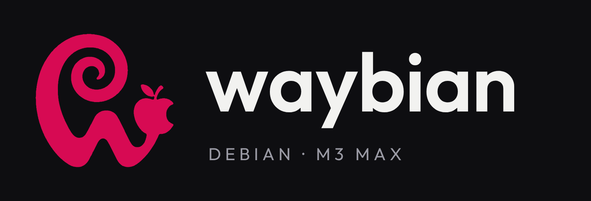
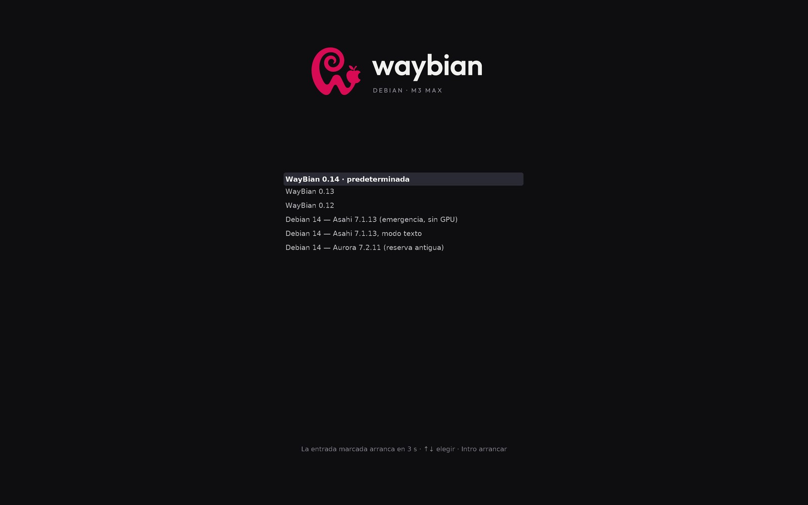
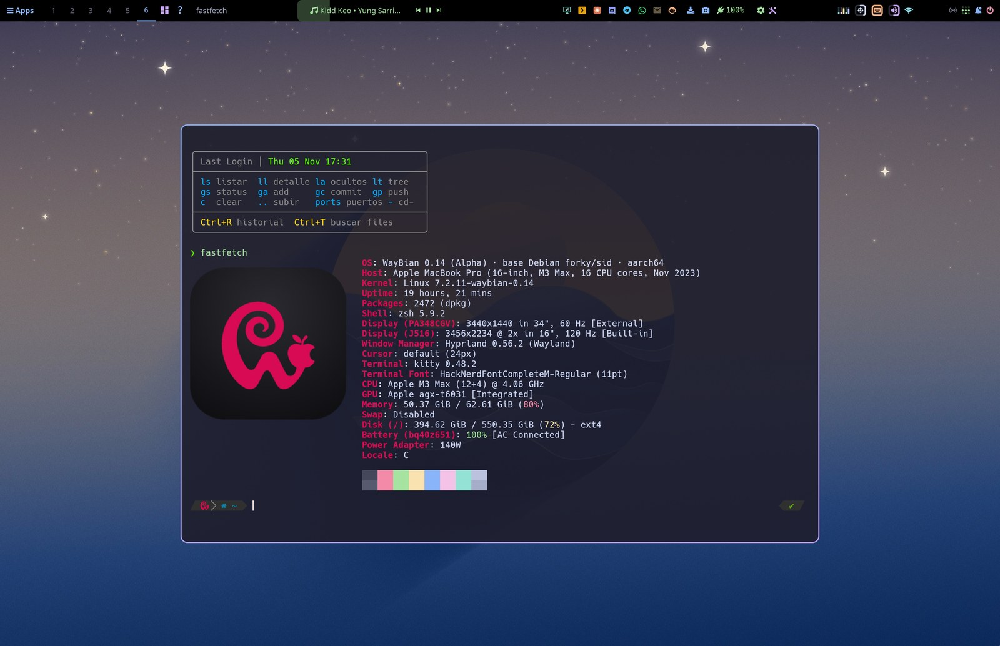
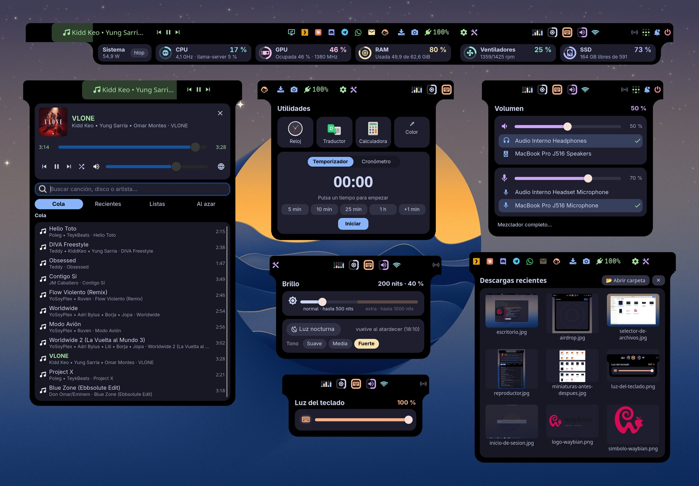
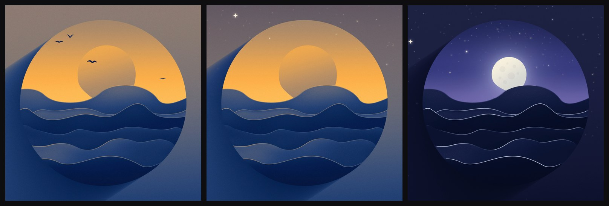
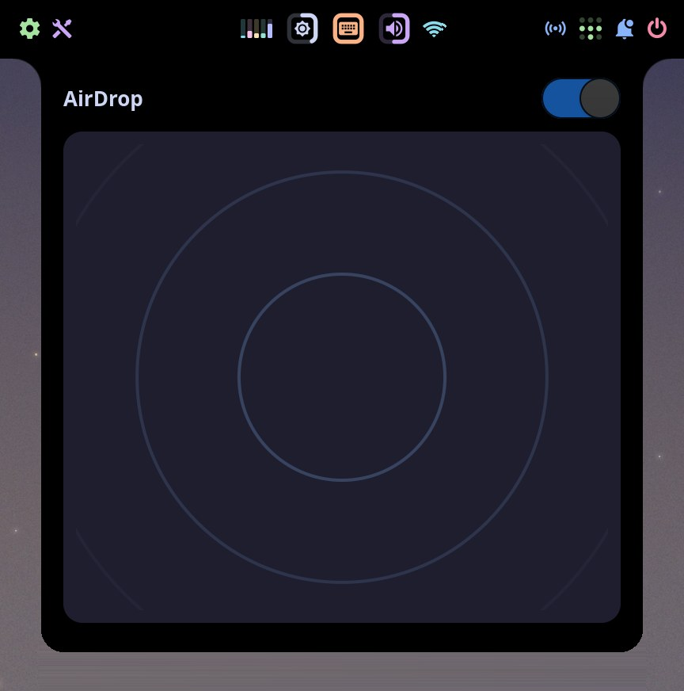
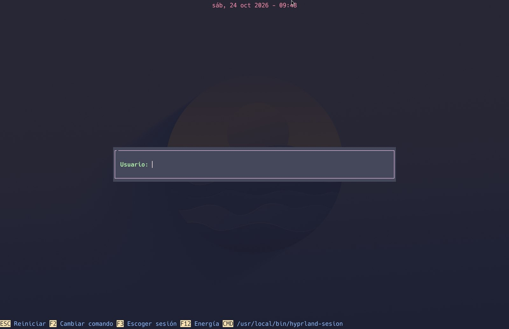
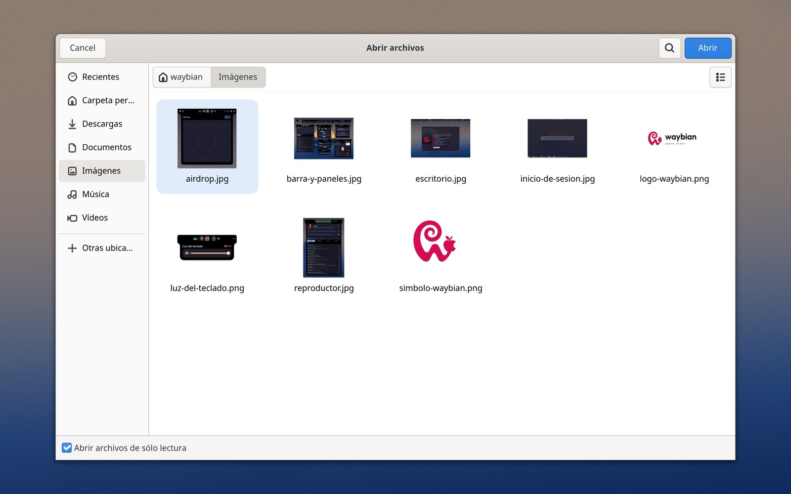
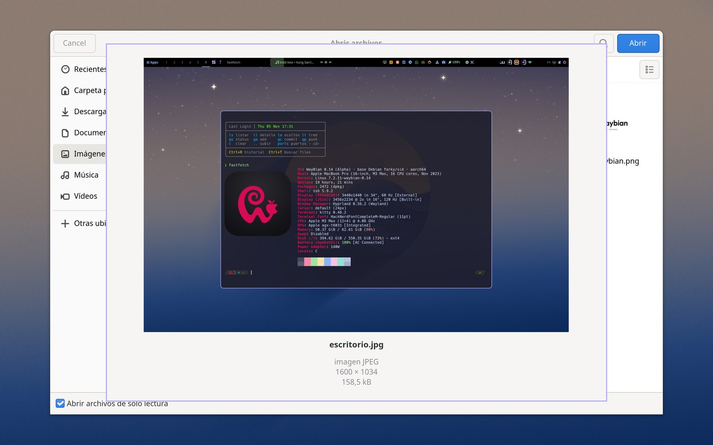

<p align="center">
  <picture>
    <source media="(prefers-color-scheme: dark)" srcset="https://github.com/samucarre/waybian/raw/main/logo/waybian-logo-oscuro.png">
    <source media="(prefers-color-scheme: light)" srcset="https://github.com/samucarre/waybian/raw/main/logo/waybian-logo-claro.png">
    
  </picture>
</p>

# WayBian

**Debian 14 arrancando de forma nativa en un MacBook Pro 16" M3 Max: escritorio Wayland (Hyprland), aceleración gráfica, Wi‑Fi, sonido, AirDrop, HDMI externo y arranque dual con macOS.**

*English: [README.md](README.md).*

WayBian (Wayland + Debian) es un Debian montado a mano (Debian 14 «forky», la rama testing, desde el 27-oct-2026; empezó en Debian 13 «trixie») para el MacBook Pro 16" de 2023 con el Apple M3 Max (placa `j516c`, SoC `t6031`). Nadie da un Linux hecho para esta máquina: el soporte del M3 en Asahi Linux (septiembre de 2026) es un kernel inicial sin driver de gráfica ni distribución, y el instalador de Debian para Apple Silicon («Bananas») solo acepta firmware de M1/M2. WayBian junta las piezas (la cadena de arranque de Asahi, el kernel y el driver de GPU de Aurora Silicon, el sistema de Debian) y arregla lo que falta entre medias.

Este repositorio es la **presentación** del proyecto: qué es, cómo funciona, qué va y qué no, y qué piezas se han cambiado. Existe para compartir el resultado con quien quiera lo mismo y para aprender de quien sepa más. Los issues y las discusiones están abiertos.

El registro del día a día (cada cambio con su porqué, el espejo de todos los ficheros de configuración, los parches y los scripts que reconstruyen el sistema desde cero) está en otro repositorio privado, `waybian-lab`. Pide lo que necesites de él.

> **Estado (5-nov-2026):** alfa, en uso diario como máquina principal del autor desde el 22-oct-2026. Subido en el sitio de Debian 13 a Debian 14 el 27-oct-2026 tras un ensayo en contenedor (qué se rompió y cómo se arregló: [docs/software.md](docs/software.md#debian-14)). Kernel `7.2.11-waybian-0.14`, el decimocuarto kernel propio desde el 26-oct. Hay aristas.

## Repositorios

WayBian está repartido en varios repositorios; este es el que los une.

| Repositorio | Qué es |
|---|---|
| **samucarre/waybian** (este) | La presentación: qué funciona y cómo, cada cambio explicado en [`docs/`](docs), capturas y los parches de cada fork en [`patches/`](patches). |
| Los forks: [Waybar](https://github.com/samucarre/Waybar) · [SwayNotificationCenter](https://github.com/samucarre/SwayNotificationCenter) · [aquamarine](https://github.com/samucarre/aquamarine) · [Postcard](https://github.com/samucarre/postcard) · [omdrop-awdl](https://github.com/samucarre/omdrop-awdl) · [libva-v4l2_request](https://github.com/samucarre/libva-v4l2_request) · [xdg-desktop-portal-gtk4](https://github.com/samucarre/xdg-desktop-portal-gtk4) | Los programas que han necesitado un cambio, cada uno en su fork y su rama. La carpeta [`forks/`](forks) enlaza cada uno al commit exacto que corre en la máquina y lo explica; qué cambia cada uno: [Las piezas que se han cambiado](#las-piezas-que-se-han-cambiado). |
| [samucarre/linux-aurora](https://github.com/samucarre/linux-aurora) | El fork público del árbol del kernel de Aurora (también en [`forks/`](forks), sin descargarse por defecto), para mandar parches upstream: ocho pull requests a `omacom/linux-aurora`; a 5-nov, #259 y #287 están aceptados y los otros seis abiertos ([#258](https://github.com/omacom/linux-aurora/pull/258) aviso de la GPU al gestor de energía, [#259](https://github.com/omacom/linux-aurora/pull/259) brillo del panel del J516C, [#260](https://github.com/omacom/linux-aurora/pull/260) un arreglo de la decodificación AV1, [#261](https://github.com/omacom/linux-aurora/pull/261) más trabajos de GPU en vuelo, [#285](https://github.com/omacom/linux-aurora/pull/285) la alarma RTC del M3 Max para la suspensión, [#284](https://github.com/omacom/linux-aurora/pull/284) una marca por placa para el apagado del panel, [#287](https://github.com/omacom/linux-aurora/pull/287) la renumeración de los sellos de la GPU, [#288](https://github.com/omacom/linux-aurora/pull/288) la GPU encendida durante la suspensión). |
| El repositorio de laboratorio (privado) | El diario de cada día, un espejo de cada fichero de configuración y los scripts que reconstruyen el sistema desde cero. |
| El fork del kernel (privado) | El árbol de Aurora con parches locales, configuraciones y scripts de instalación ([docs/kernel-gpu.md](docs/kernel-gpu.md)). |

## La máquina

| | |
|---|---|
| Modelo | MacBook Pro 16" (2023), `Mac15,9` |
| SoC | Apple M3 Max `t6031`: CPU de 16 núcleos (12P + 4E), GPU de 40 núcleos (G15C), 64 GB |
| Identificador de placa | `j516c` (`t6031-j516c.dts` en el kernel) |
| Disco | SSD de 1 TB: macOS 27 en 363,2 GiB, raíz de Linux de 560,2 GiB (ext4), los dos en el mismo disco; la raíz se amplió el 4-nov-2026 con espacio quitado a macOS |
| Debian | 14 «forky» (testing), subido desde 13 «trixie» el 27-oct-2026 |
| Tamaño de página | 16 KiB (lo exigen las IOMMU de Apple; algún binario da por hecho 4 KiB) |

## Qué funciona

| Componente | Estado | Notas |
|---|---|---|
| Arranque dual con macOS | ✅ | Encender → Debian; mantener el botón → macOS. macOS intacto (su propio contenedor APFS, Full Security). |
| CPU, NVMe, memoria | ✅ | Páginas de 16 KiB. |
| **GPU** (G15C, 40 núcleos) | ✅ | Driver y Mesa de Aurora Silicon. OpenGL 4.6 y Vulkan 1.4; el compositor gasta ~2 % de CPU. |
| Pantalla interna 3456×2234, 120 Hz | ✅ | Escala 2 en Hyprland. **Brillo hasta 1000 nits** (parche local del kernel para esta placa; el driver lo cortaba en 500): el panel del brillo de la barra tiene un tramo normal hasta 500 y otro «extra» hasta 1000. |
| Teclado y su retroiluminación | ✅ | El teclado del M3 no tiene teclas para la luz: la lleva un botón de la barra. |
| Trackpad | ✅ | Gestos de tres dedos para cambiar de escritorio. |
| Wi‑Fi (BCM4388) | ✅ | Firmware extraído de macOS por el instalador (`vendorfw`); los arreglos del initramfs que hicieron falta están en [docs/hardware.md](docs/hardware.md). Desde el 2-nov carga la base de datos regulatoria (apuntaba a la copia firmada por Debian, que este kernel no acepta), y desde el kernel 0.13 el país también le llega al firmware. |
| Bluetooth | ✅ | Audio y periféricos. |
| Altavoces | ✅ | Cadena DSP de Asahi para el J516 (asahi-audio 5.0), vigilados por `speakersafetyd`. |
| Jack de auriculares | ✅ | Salida limitada a −12 dB (el DAC llega a +12 dB si no). |
| Micrófonos | ✅ | Perfil con beamforming. |
| Cámara | ✅ | `apple-isp`. |
| Batería y carga | ✅ | El tiempo restante sale de la estimación del propio SMC. |
| Puertos USB‑C (USB 3) | ✅ | Los tres, con `deferred_probe_timeout=10` (los controladores type‑C esperan a un driver USB4 que aún no existe). |
| **Salida HDMI** | ✅ | Monitor ultrapanorámico a 3440×1440 y 60 Hz, con un `aquamarine` parcheado. 100 Hz pendiente. |
| Decodificación de vídeo por hardware (AVD) | ✅ | H.264 / HEVC / VP9 / AV1 por VA‑API (`libva-v4l2-request`): Chrome, mpv, GStreamer. Unos 5 W menos en una página de vídeo. |
| AirDrop | ✅ | En los dos sentidos con un iPhone, por el AWDL del propio chip Wi‑Fi (`omdrop`). |
| Suspensión | 🟡 | La suspensión en reposo (s2idle) funciona lanzada a mano (`rtcwake`), **también con la GPU**, y la despierta la alarma del RTC (desde el kernel 0.9; tres de tres en las pruebas, también con la 0.13). Aún no va con la tapa: cerrarla bloquea la sesión y apaga el panel, y abrirla lo vuelve a encender; no está medido cuánta batería gasta dormido. Ver [docs/hardware.md](docs/hardware.md#suspend). |
| Thunderbolt / USB4 | ❌ | Sin driver. |
| DisplayPort por USB‑C | ❌ | Investigado; necesita trabajo en kernel y arranque. |
| Leer el disco de macOS | ❌ | APFS cifrado por hardware; los ficheros van por red. |

Detalle por componente, con los arreglos que hicieron falta: [docs/hardware.md](docs/hardware.md).

## Probarlo o instalarlo

En la [página de la release](https://github.com/samucarre/waybian/releases/latest) hay una imagen alfa del sistema entero: un disco de 40 GB (GPT: ESP + raíz ext4) sin cuentas ni datos de nadie, con un asistente que crea la tuya en el primer arranque.

- **En una máquina virtual:** arráncala en QEMU con el script `waybian-qemu.sh` de la release (las notas explican cómo).
- **En un MacBook Pro 16" M3 Max (J516C):** todavía no hay paquete para el instalador de Asahi, pero el contenido de la imagen se puede copiar al Mac a mano desde macOS: el instalador de Asahi en modo «UEFI environment only», luego la raíz a una partición nueva y `boot.bin` + GRUB a su ESP. Paso a paso en [docs/install.es.md](docs/install.es.md).

## Cómo arranca

```
Botón de encendido
 └─ Boot ROM → iBoot (Apple, firmado)                        no se toca
     └─ Contenedor APFS «Debian» (stub, Permissive Security)   lo crea el instalador de Asahi
         └─ m1n1 etapa 1 → ESP/m1n1/boot.bin (m1n1 etapa 2 + device trees + U‑Boot)
             └─ U‑Boot (UEFI) → ESP/EFI/BOOT/BOOTAA64.EFI (GRUB)
                 └─ Linux (kernel Aurora/Asahi) + initramfs → Debian 14 → greetd → Hyprland
```

GRUB lleva tema propio, con los tres últimos kernels de WayBian, el de Asahi como entrada de emergencia y el primer kernel de Aurora como reserva antigua:

<p align="center">
  <br>
  <sub>El menú de arranque (el GRUB de verdad con su tema, capturado en QEMU a la resolución del framebuffer de arranque, 3456×2160).</sub>
</p>

El instalador de Asahi se usa en su modo **«UEFI environment only»**: encoge macOS, crea el contenedor stub con el firmware de macOS 14.8.3, instala m1n1 + U‑Boot y una ESP, y nada más. Debian se escribe encima a mano. Los paquetes `m1n1`, `u-boot-asahi` y `asahi-platform` de Debian están bloqueados: no conocen el M3 y su hook de instalación reescribiría `boot.bin` y dejaría el Mac sin arrancar. Más en [docs/boot-chain.md](docs/boot-chain.md).

## Kernel y GPU

- **Kernel «WayBian 0.15»**: la rama `integration/aurora` de Aurora Silicon del 6-nov-2026 fusionada con **Linux 7.2.15** y con varios PRs de Aurora todavía abiertos (entre ellos: el reparto de la GPU cuando un programa de cómputo, como una IA local, la acapara, para que el escritorio siga teniendo su turno; dos arreglos del Wi‑Fi para la suspensión; y la huella del firmware de la GPU de este Mac, ya oficial, #340), más parches locales (brillo del panel en esta placa, hasta 1000 nits, HDMI externo por la tarjeta `apple-drm-ext`, ocho trabajos de GPU en vuelo por programa y la GPU encendida durante la suspensión), páginas de 16 KiB, con BTF y sin SELinux, compilado en local. Desde la 0.13 el cargador de arranque lleva el device tree de ese kernel (un `boot.bin` nuevo; el anterior se queda en la ESP para volver); la 0.15 sigue con el mismo. GRUB conserva los tres últimos kernels de WayBian y el 7.1.13 de Asahi como entrada de emergencia; un kernel nuevo se prueba una vez con `grub-reboot` antes de ser el predeterminado (la 0.3 fue la excepción: GRUB ignoraba `next_entry` hasta que se rehízo su imagen).
- **GPU**: el M3 estrena generación de GPU (G15) y Asahi aún no la maneja. Antes de adoptar el driver de Aurora, el autor portó a la G15C un driver experimental de otra variante del M3 hasta tener cálculo estable (33 rondas de depuración en un día); las lecciones están en [docs/kernel-gpu.md](docs/kernel-gpu.md). Hoy: «Apple M3 Max (G15C B2)», 40 núcleos en 4 grupos, OpenGL 4.6 y Vulkan 1.4, Hyprland con aceleración de verdad.
- **Vídeo**: el firmware del AVD es software libre (`aurora-silicon/avd-fw`), compilado en local e instalado por versión de kernel.

## Escritorio

Hyprland 0.56 sobre Wayland, con una forma de trabajar que conserva las costumbres de macOS:

- **Waybar portada a GTK4** (nuestro fork de la PR de upstream), con botones hechos a mano: un «puesto de trabajo» en un clic, un panel de recientes con arrastrar y soltar, contadores de mensajería (Discord, Telegram, WhatsApp, correo), botones de LinkedIn, GitHub, Instagram, Facebook y TikTok (cada uno abre la web como ventana de aplicación del navegador, con tu propia cuenta; al esconderla se pausa lo que suena), escritorios remotos por grupos, un panel de Wi‑Fi que reintenta, una chuleta de atajos, una tira «Sistema» (consumo, CPU, GPU, RAM, ventiladores, SSD), el brillo (normal hasta 500 nits, «extra» hasta 1000, y la luz nocturna), luz del teclado, volumen, «Utilidades» (reloj, traductor, calculadora, cuentagotas y un temporizador/cronómetro cuyo tiempo se ve en la barra), Tailscale, AirDrop y un pequeño reproductor de música (cliente Subsonic/Navidrome que suena por mpv; el botón de la barra marca de dónde sale el audio, el reproductor o una web en Chrome).
- **Paneles que cuelgan de la barra**: cada panel, menú y globo, y el centro de notificaciones, sale del filo de la barra como un cajón, con «orejas» redondeadas donde se junta con ella: en negro en el portátil y con los colores de su barra en el monitor externo. Hasta las ventanas de las utilidades (reloj, traductor, calculadora) se abren pegadas a ella. El lanzador de aplicaciones cuelga del notch, y ⌘C enseña «Copiado» como una pestaña del notch. Los globos y los menús vienen de nuestro fork de Waybar; el cajón del centro de notificaciones, de nuestro fork de swaync.
- **Fondo animado**: el mismo dibujo, con las olas moviéndose dentro del círculo: gaviotas de día, estrellas al atardecer y la luna de noche, según la puesta de sol local. Solo se mueve en un escritorio vacío (reproducirlo gasta unos 4 W aunque esté tapado).
- **Atajos de Mac**: ⌘C/⌘V/⌘X en todas partes (en la terminal se traducen a Ctrl+Shift, porque allí Ctrl+C interrumpe; ⌘C/⌘X confirman lo copiado), ⌘A, ⌘F, ⌘R, ⌘W, ⌘T, ⌘⏎, ⌘+/⌘−, Ctrl+⌘F para pantalla completa; capturas ⌘⇧3/4/5 con la miniatura flotante; gestos de tres dedos.
- **Luz nocturna** como shader de Hyprland según la puesta de sol local (el driver de pantalla aún no expone matriz de color), que se quita de las capturas después.
- **AirDrop** desde y hacia un iPhone, con una tarjeta que se puede arrastrar desde que llega el fichero; las fotos se enderezan al llegar.
- **Inicio de sesión**: greetd con un greeter de Hyprland mínimo (fondo + terminal translúcida), dibujado por CPU para que funcione aunque falle la GPU, con caída a la consola si lo gráfico no aparece en 40 s.
- **Configuración en Lua**: Hyprland 0.56 avisa de que la 0.57 quita el formato `.conf`, así que la configuración ya es Lua; un pequeño envoltorio de `hyprctl` traduce más de 60 dispatchers del formato antiguo y cualquier keyword de configuración, y los scripts, la barra y el demonio de inactividad siguen funcionando.
- **GTK4 en todo**: Nautilus, diálogos de ficheros con un portal GTK4 compilado de nuestro fork con **vista rápida** (Espacio sobre un fichero, como en el Finder; imágenes, y PDF o vídeos por los generadores de miniaturas del sistema) y miniaturas hechas de antemano, Chrome con su backend GTK4, fuzzel, satty y **Postcard** como cliente de correo (compilado de nuestro fork contra el GTK 4.24 y la libadwaita 1.10 de Debian 14, con el Python 3.14 del sistema; ahora guarda el buzón entero, no solo los 50 correos más nuevos de cada carpeta).

Más, con el porqué de cada decisión: [docs/desktop.md](docs/desktop.md). El inventario completo de software (qué viene empaquetado, qué compilamos nosotros, qué dibuja con la GPU y por qué GTK4): [docs/software.md](docs/software.md).

<p align="center">
  <br>
  <sub>El escritorio, con el panel de información del sistema.</sub>
</p>
<p align="center">
  <br>
  <sub>Los paneles, cada uno colgado de su botón de la barra: la tira «Sistema», el reproductor de música, «Utilidades», el brillo, la luz del teclado, el volumen y las descargas recientes (aquí con una carpeta de demostración).</sub>
</p>
<p align="center">
  <br>
  <sub>El fondo animado de día, al atardecer y de noche.</sub>
</p>
<p align="center">
  
  <br>
  <sub>El panel de AirDrop · la pantalla de inicio de sesión.</sub>
</p>
<p align="center">
  
  <br>
  <sub>El diálogo de abrir con sus miniaturas, y la vista rápida al pulsar Espacio (los ficheros son capturas de WayBian).</sub>
</p>

## Software

La regla para elegir programas: lo que está en pantalla lo tiene que dibujar la GPU y no la CPU, que es lo que gasta batería. Así que: primero Wayland nativo y GTK4; si no hay, un toolkit que siga dibujando con la GPU; Electron solo cuando no queda otra. Inventario completo con notas: [docs/software.md](docs/software.md).

**Escritorio**

| Programa | Función | Dibuja con | Origen |
|---|---|---|---|
| Hyprland 0.56 | compositor | OpenGL | Debian 14 |
| aquamarine (parcheada) | backend DRM/GBM | — | **compilada de nuestro fork** |
| Waybar (port a GTK4) | barra y botones | GTK4 (Vulkan) | **compilada de nuestro fork** |
| lanzador propio · fuzzel | lanzador de aplicaciones colgado del notch · historial del portapapeles | GTK4 · Wayland nativo | nuestro · Debian 14 |
| mpvpaper (swaybg de reserva) | fondo animado | OpenGL (mpv) | **compilado del código de upstream** · Debian 14 |
| SwayNotificationCenter (swaync) 0.12.6 | centro de notificaciones | GTK4 (GPU) | **compilado de nuestro fork** |
| kitty 0.48 | terminal | OpenGL | Debian 14 |
| greetd + tuigreet + greeter propio | inicio de sesión | CPU a propósito | Debian 14 + nuestro |
| hyprlock · hypridle · hyprpicker · hyprpolkitagent | bloqueo, inactividad, cuentagotas, polkit | OpenGL / Wayland | Debian 14 |
| grim · slurp · satty | capturas y anotación | satty: GTK4 | Debian 14 · satty binario upstream |
| xdg-desktop-portal-hyprland · portal-gtk4 | portales, diálogos de ficheros con vista rápida | GTK4 (Rust) | Debian 14 · **compilado de nuestro fork** |
| Nautilus 51 · Loupe 51 · sushi 50 | ficheros, imágenes, vista rápida | GTK4 + libadwaita | Debian 14 |
| pavucontrol 6 | mezclador de audio | GTK4 | Debian 14 |
| Relojes · Dialect · Calculadora | las baldosas de «Utilidades» (reloj, traductor, calculadora) | GTK4 + libadwaita | Debian 14 |
| PipeWire · WirePlumber · asahi-audio · speakersafetyd | sonido | — | Debian 14 + Asahi |
| NetworkManager + iwd | red | — | Debian 14 |
| ~30 paneles y herramientas propias | recientes, mensajería, escritorios remotos, Wi‑Fi, brillo, volumen, luz del teclado, utilidades, tira del sistema, AirDrop, música, luz nocturna… | Python + GTK4 | nuestros |

**Aplicaciones**

| Programa | Dibuja con | Origen |
|---|---|---|
| Google Chrome | Chromium, diálogos GTK4 (`--gtk-version=4`), vídeo por hardware | repositorio del fabricante |
| Postcard (correo) | GTK 4.24 + libadwaita 1.10 + WebKitGTK, Python 3.14 | **compilado de nuestro fork** |
| WordCraft · GridCraft · DeckCraft · PdfCraft · PhotoCraft | Rust (iced) sobre Vulkan | releases upstream |
| LibreOffice | GTK3, solo sin ventana y oculto del menú: la herramienta con la que el asistente de IA (Claude Code) crea y convierte documentos de Office, porque los MCP de las Craft todavía no le sirven lo bastante; abre también los formatos antiguos .xls/.ppt/.odp | Debian 14 |
| mpv 0.41 | OpenGL/Vulkan, `hwdec` | Debian 14 |
| Telegram Desktop 5.7 | Qt 5 + Vulkan | Debian 14 |
| WhatsApp | ventana de app de Chrome | — |
| Vesktop (Discord) · Claude Desktop | Electron (GTK3) | upstream |
| Remmina 1.4 | GTK3 | Debian 14 |
| Steam · Tailscale · Claude Code | — | upstream |

**Compilado por nosotros, no de apt:** Waybar GTK4, SwayNotificationCenter, aquamarine, libva-v4l2_request, Postcard, xdg-desktop-portal-gtk4, mpvpaper, la Mesa de Aurora, el firmware del AVD y el kernel. Todavía sin GTK4: las apps Electron (Electron ignora la opción), LibreOffice (su backend GTK4 casca) y Remmina (sin port).

## Las piezas que se han cambiado

Cada programa que ha necesitado un cambio tiene un fork con su rama, para poder reconstruir el sistema sin esperar a upstream:

| Programa | Fork / rama | Qué cambia |
|---|---|---|
| Waybar | [samucarre/Waybar](https://github.com/samucarre/Waybar) `gtk4-debian13-m3` | port a GTK4 (PR Alexays/Waybar#5366) + arreglos: un segfault en `hyprland/workspaces`, menús de los módulos, sobrevivir al quitar/poner un monitor, `align` en los módulos custom, clics en los escritorios con la configuración Lua de Hyprland; los globos y menús propios de la barra, colgados de su filo y abriéndose como un cajón |
| SwayNotificationCenter | [samucarre/SwayNotificationCenter](https://github.com/samucarre/SwayNotificationCenter) `debian13-m3` | el centro de notificaciones se abre con el mismo cajón que los paneles de la barra |
| aquamarine | [samucarre/aquamarine](https://github.com/samucarre/aquamarine) `hdmi-apple-drm-ext-0.15` | renderer GBM para una tarjeta DRM sin nodo de render (el HDMI del M3) |
| omdrop-awdl | [samucarre/omdrop-awdl](https://github.com/samucarre/omdrop-awdl) `discoverable-rapido` | visible/invisible más rápido desde la barra; transferencias más rápidas cuando la red de casa va por un canal que AWDL no visita |
| Postcard | [samucarre/postcard](https://github.com/samucarre/postcard) `debian13-m3` | OAuth de Google con refresh token guardado (sin GNOME Online Accounts), IMAP IDLE en Python < 3.14, una rareza del `SEARCH ALL` de iCloud, interruptor «agrupar conversaciones», arreglo del sandbox de WebKit con un driver GL que no es Mesa, imágenes `cid:` y cuerpos que salían en blanco, un llavero sustituido con Postcard abierto, una hoja de estilo del usuario, el buzón entero bajado en segundo plano, receta para Debian 13 (en Debian 14 bastan el GTK y el Python del sistema) |
| libva-v4l2_request | [samucarre/libva-v4l2_request](https://github.com/samucarre/libva-v4l2_request) | espejo (driver VA‑API del AVD) |
| xdg-desktop-portal-gtk4 | [samucarre/xdg-desktop-portal-gtk4](https://github.com/samucarre/xdg-desktop-portal-gtk4/tree/waybian) `waybian` | vista rápida en los diálogos de abrir GTK4 (Espacio, como en el Finder), también de PDF y vídeos por los generadores de miniaturas del sistema |
| Kernel | fork privado del árbol de Aurora | parches locales, configuraciones y scripts de instalación; varios de los parches están propuestos upstream desde el fork público [samucarre/linux-aurora](https://github.com/samucarre/linux-aurora) (pull requests #258–#261, #284, #285, #287, #288); ver [docs/kernel-gpu.md](docs/kernel-gpu.md) |

Los forks están montados como submódulos de git en [`forks/`](forks) (cada uno fijado al commit exacto que corre en la máquina), y cada commit de código nuestro se puede leer también como parche en [`patches/`](patches). Lista completa, bases y recetas: [docs/forks.md](docs/forks.md).

## Cómo se hizo

El kernel y el sistema de ficheros raíz se construyeron en una máquina virtual Linux arm64, se probaron en QEMU con el mismo camino UEFI → GRUB → kernel y se escribieron en el Mac desde macOS. Desde entonces cada cambio se hace en la máquina viva y queda anotado. Reproducir el sistema es ejecutar los scripts base una vez y después un script `aplicar.sh` idempotente; ver [docs/reproduce.md](docs/reproduce.md). Todo se ha hecho con un asistente de programación con IA de copiloto (Claude Code): el autor decide qué y por qué; el asistente lee registros, escribe los scripts y prueba; cualquier cambio de kernel, arranque o GRUB se explica antes y siempre tiene camino de vuelta.

## Lo que falta y en lo que nos vendría bien ayuda

- Suspensión al cerrar la tapa (suspender ya funciona desde el kernel 0.9; falta medir cuánta batería gasta), USB4/Thunderbolt y DisplayPort por USB‑C: aún no.
- HDMI a 100 Hz (el monitor y el cable lo admiten; la ruta de pantalla negocia 60 Hz).
- Preempción de la GPU: el driver G15 de Aurora aún no interrumpe el cálculo, así que mientras dura un cómputo largo de GPU el escritorio espera a que acabe cada envío y se congela.
- Cualquier cosa del `t6031`/G15 que tengamos mal.

Abre un [issue](../../issues) o una [discusión](../../discussions).

## Créditos

[Asahi Linux](https://asahilinux.org) (m1n1, U‑Boot, el instalador, el trabajo de kernel, `asahi-audio`, `speakersafetyd`), [Aurora Silicon](https://github.com/aurora-silicon) (integración del kernel del M3, driver de GPU y Mesa), [Debian](https://www.debian.org), [Fedora Asahi Remix](https://fedora-asahi-remix.org) (configuración del kernel), [Hyprland](https://hyprland.org), [Waybar](https://github.com/Alexays/Waybar), [SwayNotificationCenter](https://github.com/ErikReider/SwayNotificationCenter), [mpvpaper](https://github.com/GhostNaN/mpvpaper), [omdrop](https://github.com/netmojo-systems/omdrop-awdl), [Postcard](https://github.com/gxanshu/postcard), Martin Martz (la foto del fondo, en [Unsplash](https://unsplash.com/photos/VDKA7N_v_hI)) y toda la gente cuya ingeniería inversa hace posible Linux en Apple Silicon.

## Licencia

Los textos y las imágenes de este repositorio están bajo [CC BY-NC 4.0](LICENSE): puedes compartirlos y adaptarlos sin fines comerciales, citando «Samuel Carreño, WayBian» con un enlace aquí; para cualquier uso comercial hace falta permiso previo del autor. Los parches de [`patches/`](patches) conservan la licencia del programa al que se aplican, y los forks, la de su upstream. El fondo de las capturas parte de una foto de Martin Martz con la [licencia de Unsplash](https://unsplash.com/license).
