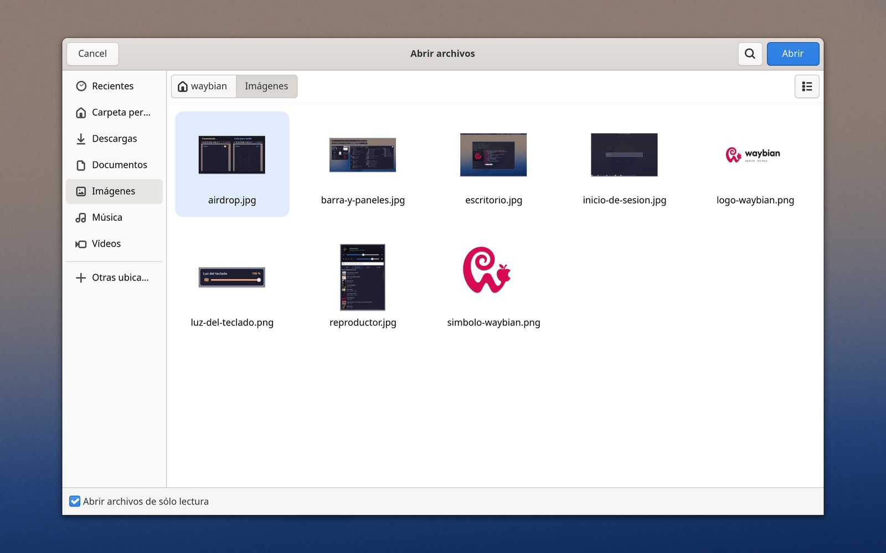
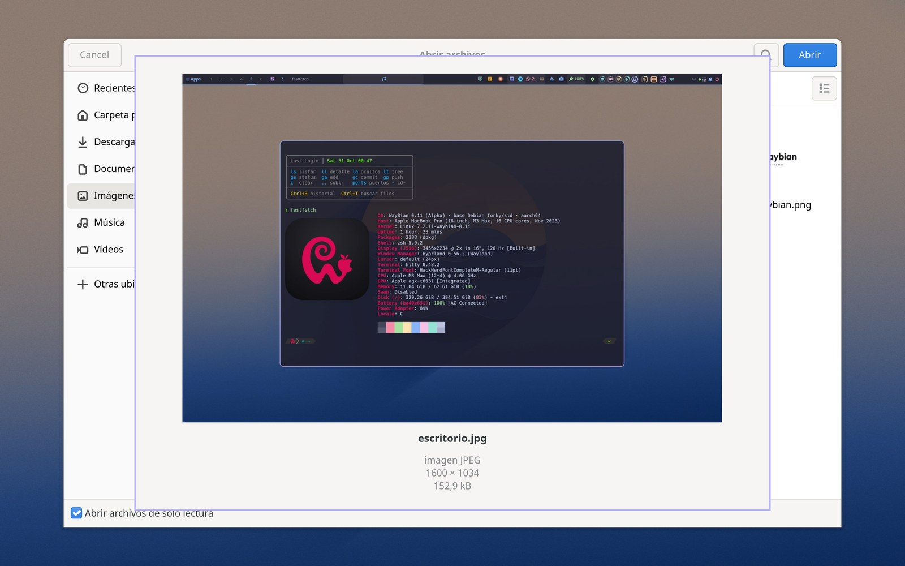

<p align="center">
  <picture>
    <source media="(prefers-color-scheme: dark)" srcset="https://github.com/samucarre/waybian/raw/main/logo/waybian-logo-oscuro.png">
    <source media="(prefers-color-scheme: light)" srcset="https://github.com/samucarre/waybian/raw/main/logo/waybian-logo-claro.png">
    
  </picture>
</p>

# WayBian

**Debian 14 arrancando de forma nativa en un MacBook Pro 16" M3 Max: escritorio Wayland (Hyprland), aceleración gráfica, Wi‑Fi, sonido, AirDrop, HDMI externo y arranque dual con macOS.**

*English: [README.md](README.md).*

WayBian (Wayland + Debian) es un Debian montado a mano (Debian 14 «forky», la rama testing, desde el 27-oct-2026; empezó en Debian 13 «trixie») para el MacBook Pro 16" de 2023 con el Apple M3 Max (placa `j516c`, SoC `t6031`). Nadie da un Linux hecho para esta máquina: el soporte del M3 en Asahi Linux (septiembre de 2026) es un kernel inicial sin driver de gráfica ni distribución, y el instalador de Debian para Apple Silicon («Bananas») solo acepta firmware de M1/M2. WayBian junta las piezas (la cadena de arranque de Asahi, el kernel y el driver de GPU de Aurora Silicon, el sistema de Debian) y arregla lo que falta entre medias.

Este repositorio es la **presentación** del proyecto: qué es, cómo funciona, qué va y qué no, y qué piezas se han cambiado. Existe para compartir el resultado con quien quiera lo mismo y para aprender de quien sepa más. Los issues y las discusiones están abiertos.

El registro del día a día (cada cambio con su porqué, el espejo de todos los ficheros de configuración, los parches y los scripts que reconstruyen el sistema desde cero) está en otro repositorio privado, `waybian-lab`. Pide lo que necesites de él.

> **Estado (29-oct-2026):** alfa, en uso diario como máquina principal del autor desde el 22-oct-2026. Subido en el sitio de Debian 13 a Debian 14 el 27-oct-2026 tras un ensayo en contenedor (qué se rompió y cómo se arregló: [docs/software.md](docs/software.md#debian-14)). Kernel `7.2.11-waybian-0.4`. Hay aristas.

## Repositorios

WayBian está repartido en varios repositorios; este es el que los une.

| Repositorio | Qué es |
|---|---|
| **samucarre/waybian** (este) | La presentación: qué funciona y cómo, cada cambio explicado en [`docs/`](docs), capturas y los parches de cada fork en [`patches/`](patches). |
| Los forks: [Waybar](https://github.com/samucarre/Waybar) · [aquamarine](https://github.com/samucarre/aquamarine) · [Postcard](https://github.com/samucarre/postcard) · [omdrop-awdl](https://github.com/samucarre/omdrop-awdl) · [libva-v4l2_request](https://github.com/samucarre/libva-v4l2_request) · [xdg-desktop-portal-gtk4](https://github.com/samucarre/xdg-desktop-portal-gtk4) | Los programas que han necesitado un cambio, cada uno en su fork y su rama. La carpeta [`forks/`](forks) enlaza cada uno al commit exacto que corre en la máquina y lo explica; qué cambia cada uno: [Las piezas que se han cambiado](#las-piezas-que-se-han-cambiado). |
| [samucarre/linux-aurora](https://github.com/samucarre/linux-aurora) | El fork público del árbol del kernel de Aurora (también en [`forks/`](forks), sin descargarse por defecto), para mandar parches upstream: cuatro pull requests a `omacom/linux-aurora`, abiertos a 29-oct ([#258](https://github.com/omacom/linux-aurora/pull/258) aviso de la GPU al gestor de energía, [#259](https://github.com/omacom/linux-aurora/pull/259) brillo del panel del J516C, [#260](https://github.com/omacom/linux-aurora/pull/260) un arreglo de la decodificación AV1, [#261](https://github.com/omacom/linux-aurora/pull/261) más trabajos de GPU en vuelo). |
| El repositorio de laboratorio (privado) | El diario de cada día, un espejo de cada fichero de configuración y los scripts que reconstruyen el sistema desde cero. |
| El fork del kernel (privado) | El árbol de Aurora con parches locales, configuraciones y scripts de instalación ([docs/kernel-gpu.md](docs/kernel-gpu.md)). |

## La máquina

| | |
|---|---|
| Modelo | MacBook Pro 16" (2023), `Mac15,9` |
| SoC | Apple M3 Max `t6031`: CPU de 16 núcleos (12P + 4E), GPU de 40 núcleos (G15C), 64 GB |
| Identificador de placa | `j516c` (`t6031-j516c.dts` en el kernel) |
| Disco | SSD de 1 TB: macOS 27 en 521,5 GiB, raíz de Linux de 401,9 GiB (ext4), los dos en el mismo disco |
| Debian | 14 «forky» (testing), subido desde 13 «trixie» el 27-oct-2026 |
| Tamaño de página | 16 KiB (lo exigen las IOMMU de Apple; algún binario da por hecho 4 KiB) |

## Qué funciona

| Componente | Estado | Notas |
|---|---|---|
| Arranque dual con macOS | ✅ | Encender → Debian; mantener el botón → macOS. macOS intacto (su propio contenedor APFS, Full Security). |
| CPU, NVMe, memoria | ✅ | Páginas de 16 KiB. |
| **GPU** (G15C, 40 núcleos) | ✅ | Driver y Mesa de Aurora Silicon. OpenGL 4.6 y Vulkan 1.4; el compositor gasta ~2 % de CPU. |
| Pantalla interna 3456×2234 | ✅ | Escala 2 en Hyprland. **Brillo** funciona (parche local del kernel para esta placa). |
| Teclado y su retroiluminación | ✅ | El teclado del M3 no tiene teclas para la luz: la lleva un botón de la barra. |
| Trackpad | ✅ | Gestos de tres dedos para cambiar de escritorio. |
| Wi‑Fi (BCM4388) | ✅ | Firmware extraído de macOS por el instalador (`vendorfw`); los arreglos del initramfs que hicieron falta están en [docs/hardware.md](docs/hardware.md). |
| Bluetooth | ✅ | Audio y periféricos. |
| Altavoces | ✅ | Cadena DSP de Asahi para el J516 (asahi-audio 5.0), vigilados por `speakersafetyd`. |
| Jack de auriculares | ✅ | Salida limitada a −12 dB (el DAC llega a +12 dB si no). |
| Micrófonos | ✅ | Perfil con beamforming. |
| Cámara | ✅ | `apple-isp`. |
| Batería y carga | ✅ | El tiempo restante sale de la estimación del propio SMC. |
| Puertos USB‑C (USB 3) | ✅ | Los tres, con `deferred_probe_timeout=10` (los controladores type‑C esperan a un driver USB4 que aún no existe). |
| **Salida HDMI** | ✅ | Monitor ultrapanorámico a 3440×1440 y 60 Hz, con un `aquamarine` parcheado. 100 Hz pendiente. |
| Decodificación de vídeo por hardware (AVD) | ✅ | H.264 / HEVC / VP9 / AV1 por VA‑API (`libva-v4l2-request`): Chrome, mpv, GStreamer. Unos 5 W menos en una página de vídeo. |
| AirDrop | ✅ | En los dos sentidos con un iPhone, por el AWDL del propio chip Wi‑Fi (`omdrop`). |
| Suspensión | ❌ | Aún no hay en el M3. Cerrar la tapa bloquea la sesión. |
| Thunderbolt / USB4 | ❌ | Sin driver. |
| DisplayPort por USB‑C | ❌ | Investigado; necesita trabajo en kernel y arranque. |
| Leer el disco de macOS | ❌ | APFS cifrado por hardware; los ficheros van por red. |

Detalle por componente, con los arreglos que hicieron falta: [docs/hardware.md](docs/hardware.md).

## Cómo arranca

```
Botón de encendido
 └─ Boot ROM → iBoot (Apple, firmado)                        no se toca
     └─ Contenedor APFS «Debian» (stub, Permissive Security)   lo crea el instalador de Asahi
         └─ m1n1 etapa 1 → ESP/m1n1/boot.bin (m1n1 etapa 2 + device trees + U‑Boot)
             └─ U‑Boot (UEFI) → ESP/EFI/BOOT/BOOTAA64.EFI (GRUB)
                 └─ Linux (kernel Aurora/Asahi) + initramfs → Debian 14 → greetd → Hyprland
```

El instalador de Asahi se usa en su modo **«UEFI environment only»**: encoge macOS, crea el contenedor stub con el firmware de macOS 14.8.3, instala m1n1 + U‑Boot y una ESP, y nada más. Debian se escribe encima a mano. Los paquetes `m1n1`, `u-boot-asahi` y `asahi-platform` de Debian están bloqueados: no conocen el M3 y su hook de instalación reescribiría `boot.bin` y dejaría el Mac sin arrancar. Más en [docs/boot-chain.md](docs/boot-chain.md).

## Kernel y GPU

- **Kernel «WayBian 0.4»**: la rama `integration/aurora` de Aurora Silicon (Linux 7.2.11, estado del 28-oct-2026) más unos pocos parches locales (brillo del panel en esta placa, HDMI externo por la tarjeta `apple-drm-ext` y algún arreglo), páginas de 16 KiB, con BTF y sin SELinux, compilado en local. GRUB conserva el 7.1.13 de Asahi como entrada de emergencia y los kernels anteriores de reserva; un kernel nuevo se prueba una vez con `grub-reboot` antes de ser el predeterminado (la 0.3 fue la excepción: GRUB ignoraba `next_entry` hasta que se rehízo su imagen).
- **GPU**: el M3 estrena generación de GPU (G15) y Asahi aún no la maneja. Antes de adoptar el driver de Aurora, el autor portó a la G15C un driver experimental de otra variante del M3 hasta tener cálculo estable (33 rondas de depuración en un día); las lecciones están en [docs/kernel-gpu.md](docs/kernel-gpu.md). Hoy: «Apple M3 Max (G15C B2)», 40 núcleos en 4 grupos, OpenGL 4.6 y Vulkan 1.4, Hyprland con aceleración de verdad.
- **Vídeo**: el firmware del AVD es software libre (`aurora-silicon/avd-fw`), compilado en local e instalado por versión de kernel.

## Escritorio

Hyprland 0.56 sobre Wayland, con una forma de trabajar que conserva las costumbres de macOS:

- **Waybar portada a GTK4** (nuestro fork de la PR de upstream), con botones hechos a mano: un «puesto de trabajo» en un clic, un panel de recientes con arrastrar y soltar, contadores de mensajería (Discord, Telegram, WhatsApp, correo), escritorios remotos por grupos, un panel de Wi‑Fi que reintenta, una chuleta de atajos, ventiladores/temperaturas/consumo, luz del teclado, Tailscale, AirDrop y un pequeño reproductor de música (cliente Subsonic/Navidrome que suena por mpv; el botón de la barra marca de dónde sale el audio, el reproductor o una web en Chrome).
- **Atajos de Mac**: ⌘C/⌘V/⌘X en todas partes (en la terminal se traducen a Ctrl+Shift, porque allí Ctrl+C interrumpe; ⌘C/⌘X confirman lo copiado con un aviso), ⌘F, ⌘W, ⌘T, ⌘⏎, ⌘+/⌘−, Ctrl+⌘F para pantalla completa; capturas ⌘⇧3/4/5 con la miniatura flotante; gestos de tres dedos.
- **Luz nocturna** como shader de Hyprland según la puesta de sol local (el driver de pantalla aún no expone matriz de color), que se quita de las capturas después.
- **AirDrop** desde y hacia un iPhone, con una tarjeta que se puede arrastrar desde que llega el fichero; las fotos se enderezan al llegar.
- **Inicio de sesión**: greetd con un greeter de Hyprland mínimo (fondo + terminal translúcida), dibujado por CPU para que funcione aunque falle la GPU, con caída a la consola si lo gráfico no aparece en 40 s.
- **Configuración en Lua**: Hyprland 0.56 avisa de que la 0.57 quita el formato `.conf`, así que la configuración ya es Lua; un pequeño envoltorio de `hyprctl` traduce más de 60 dispatchers del formato antiguo y cualquier keyword de configuración, y los scripts, la barra y el demonio de inactividad siguen funcionando.
- **GTK4 en todo**: Nautilus, diálogos de ficheros con un portal GTK4 compilado de nuestro fork con **vista rápida** (Espacio sobre un fichero, como en el Finder) y miniaturas hechas de antemano, Chrome con su backend GTK4, fuzzel, satty y **Postcard** como cliente de correo (compilado de nuestro fork contra el GTK 4.24 y la libadwaita 1.10 de Debian 14, con el Python 3.14 del sistema).

Más, con el porqué de cada decisión: [docs/desktop.md](docs/desktop.md). El inventario completo de software (qué viene empaquetado, qué compilamos nosotros, qué dibuja con la GPU y por qué GTK4): [docs/software.md](docs/software.md).

<p align="center">
  <br>
  <sub>El escritorio, con el panel de información del sistema.</sub>
</p>
<p align="center">
  <br>
  <sub>La barra y algunos de sus paneles.</sub>
</p>
<p align="center">
  
  <br>
  <sub>AirDrop desde un iPhone · la pantalla de inicio de sesión.</sub>
</p>
<p align="center">
  
  <br>
  <sub>El diálogo de abrir con sus miniaturas, y la vista rápida al pulsar Espacio (los ficheros son capturas de WayBian).</sub>
</p>

## Software

La regla para elegir programas: lo que está en pantalla lo tiene que dibujar la GPU y no la CPU, que es lo que gasta batería. Así que: primero Wayland nativo y GTK4; si no hay, un toolkit que siga dibujando con la GPU; Electron solo cuando no queda otra. Inventario completo con notas: [docs/software.md](docs/software.md).

**Escritorio**

| Programa | Función | Dibuja con | Origen |
|---|---|---|---|
| Hyprland 0.56 | compositor | OpenGL | Debian 14 |
| aquamarine (parcheada) | backend DRM/GBM | — | **compilada de nuestro fork** |
| Waybar (port a GTK4) | barra y botones | GTK4 (Vulkan) | **compilada de nuestro fork** |
| fuzzel · mako · swaybg | lanzador · avisos · fondo | Wayland nativo | Debian 14 |
| kitty 0.48 | terminal | OpenGL | Debian 14 |
| greetd + tuigreet + greeter propio | inicio de sesión | CPU a propósito | Debian 14 + nuestro |
| hyprlock · hypridle · hyprpicker · hyprpolkitagent | bloqueo, inactividad, cuentagotas, polkit | OpenGL / Wayland | Debian 14 |
| grim · slurp · satty | capturas y anotación | satty: GTK4 | Debian 14 · satty binario upstream |
| xdg-desktop-portal-hyprland · portal-gtk4 | portales, diálogos de ficheros con vista rápida | GTK4 (Rust) | Debian 14 · **compilado de nuestro fork** |
| Nautilus 51 · Loupe 51 · sushi 50 | ficheros, imágenes, vista rápida | GTK4 + libadwaita | Debian 14 |
| pavucontrol 6 | mezclador de audio | GTK4 | Debian 14 |
| PipeWire · WirePlumber · asahi-audio · speakersafetyd | sonido | — | Debian 14 + Asahi |
| NetworkManager + iwd | red | — | Debian 14 |
| ~30 paneles y herramientas propias | recientes, mensajería, escritorios remotos, Wi‑Fi, luz del teclado, AirDrop, música, luz nocturna… | Python + GTK4 | nuestros |

**Aplicaciones**

| Programa | Dibuja con | Origen |
|---|---|---|
| Google Chrome | Chromium, diálogos GTK4 (`--gtk-version=4`), vídeo por hardware | repositorio del fabricante |
| Postcard (correo) | GTK 4.24 + libadwaita 1.10 + WebKitGTK, Python 3.14 | **compilado de nuestro fork** |
| WordCraft · GridCraft · DeckCraft · PdfCraft · PhotoCraft | Rust (iced) sobre Vulkan | releases upstream |
| LibreOffice | GTK3, solo sin ventana y oculto del menú: la herramienta con la que el asistente de IA (Claude Code) crea y convierte documentos de Office, porque los MCP de las Craft todavía no le sirven lo bastante; abre también los formatos antiguos .xls/.ppt/.odp | Debian 14 |
| mpv 0.41 | OpenGL/Vulkan, `hwdec` | Debian 14 |
| Telegram Desktop 5.7 | Qt 5 + Vulkan | Debian 14 |
| WhatsApp | ventana de app de Chrome | — |
| Vesktop (Discord) · Claude Desktop | Electron (GTK3) | upstream |
| Remmina 1.4 | GTK3 | Debian 14 |
| Steam · Tailscale · Claude Code | — | upstream |

**Compilado por nosotros, no de apt:** Waybar GTK4, aquamarine, libva-v4l2_request, Postcard, xdg-desktop-portal-gtk4, la Mesa de Aurora, el firmware del AVD y el kernel. Todavía sin GTK4: las apps Electron (Electron ignora la opción), LibreOffice (su backend GTK4 casca) y Remmina (sin port).

## Las piezas que se han cambiado

Cada programa que ha necesitado un cambio tiene un fork con su rama, para poder reconstruir el sistema sin esperar a upstream:

| Programa | Fork / rama | Qué cambia |
|---|---|---|
| Waybar | [samucarre/Waybar](https://github.com/samucarre/Waybar) `gtk4-debian13-m3` | port a GTK4 (PR Alexays/Waybar#5366) + arreglos: un segfault en `hyprland/workspaces`, menús de los módulos, sobrevivir al quitar/poner un monitor, `align` en los módulos custom, clics en los escritorios con la configuración Lua de Hyprland |
| aquamarine | [samucarre/aquamarine](https://github.com/samucarre/aquamarine) `hdmi-apple-drm-ext-0.15` | renderer GBM para una tarjeta DRM sin nodo de render (el HDMI del M3) |
| omdrop-awdl | [samucarre/omdrop-awdl](https://github.com/samucarre/omdrop-awdl) `discoverable-rapido` | visible/invisible más rápido desde la barra |
| Postcard | [samucarre/postcard](https://github.com/samucarre/postcard) `debian13-m3` | OAuth de Google con refresh token guardado (sin GNOME Online Accounts), IMAP IDLE en Python < 3.14, una rareza del `SEARCH ALL` de iCloud, interruptor «agrupar conversaciones», arreglo del sandbox de WebKit con un driver GL que no es Mesa, receta para Debian 13 (en Debian 14 bastan el GTK y el Python del sistema) |
| libva-v4l2_request | [samucarre/libva-v4l2_request](https://github.com/samucarre/libva-v4l2_request) | espejo (driver VA‑API del AVD) |
| xdg-desktop-portal-gtk4 | [samucarre/xdg-desktop-portal-gtk4](https://github.com/samucarre/xdg-desktop-portal-gtk4/tree/waybian) `waybian` | vista rápida en los diálogos de abrir GTK4 (Espacio, como en el Finder) |
| Kernel | fork privado del árbol de Aurora | parches locales, configuraciones y scripts de instalación; cuatro de los parches están propuestos upstream desde el fork público [samucarre/linux-aurora](https://github.com/samucarre/linux-aurora) (pull requests #258–#261); ver [docs/kernel-gpu.md](docs/kernel-gpu.md) |

Los forks están montados como submódulos de git en [`forks/`](forks) (cada uno fijado al commit exacto que corre en la máquina), y cada commit de código nuestro se puede leer también como parche en [`patches/`](patches). Lista completa, bases y recetas: [docs/forks.md](docs/forks.md).

## Cómo se hizo

El kernel y el sistema de ficheros raíz se construyeron en una máquina virtual Linux arm64, se probaron en QEMU con el mismo camino UEFI → GRUB → kernel y se escribieron en el Mac desde macOS. Desde entonces cada cambio se hace en la máquina viva y queda anotado. Reproducir el sistema es ejecutar los scripts base una vez y después un script `aplicar.sh` idempotente; ver [docs/reproduce.md](docs/reproduce.md). Todo se ha hecho con un asistente de programación con IA de copiloto (Claude Code): el autor decide qué y por qué; el asistente lee registros, escribe los scripts y prueba; cualquier cambio de kernel, arranque o GRUB se explica antes y siempre tiene camino de vuelta.

## Lo que falta y en lo que nos vendría bien ayuda

- Suspensión, USB4/Thunderbolt y DisplayPort por USB‑C: aún no.
- HDMI a 100 Hz (el monitor y el cable lo admiten; la ruta de pantalla negocia 60 Hz).
- Preempción de la GPU: el driver G15 de Aurora aún no interrumpe el cálculo, así que mientras dura un cómputo largo de GPU el escritorio espera a que acabe cada envío y se congela.
- Cualquier cosa del `t6031`/G15 que tengamos mal.

Abre un [issue](../../issues) o una [discusión](../../discussions).

## Créditos

[Asahi Linux](https://asahilinux.org) (m1n1, U‑Boot, el instalador, el trabajo de kernel, `asahi-audio`, `speakersafetyd`), [Aurora Silicon](https://github.com/aurora-silicon) (integración del kernel del M3, driver de GPU y Mesa), [Debian](https://www.debian.org), [Fedora Asahi Remix](https://fedora-asahi-remix.org) (configuración del kernel), [Hyprland](https://hyprland.org), [Waybar](https://github.com/Alexays/Waybar), [omdrop](https://github.com/netmojo-systems/omdrop-awdl), [Postcard](https://github.com/gxanshu/postcard) y toda la gente cuya ingeniería inversa hace posible Linux en Apple Silicon.

## Licencia

Los textos y las imágenes de este repositorio están bajo [CC BY 4.0](LICENSE): puedes reutilizarlos y adaptarlos citando «Samuel Carreño, WayBian» con un enlace aquí. Los parches de [`patches/`](patches) conservan la licencia del programa al que se aplican, y los forks, la de su upstream.
