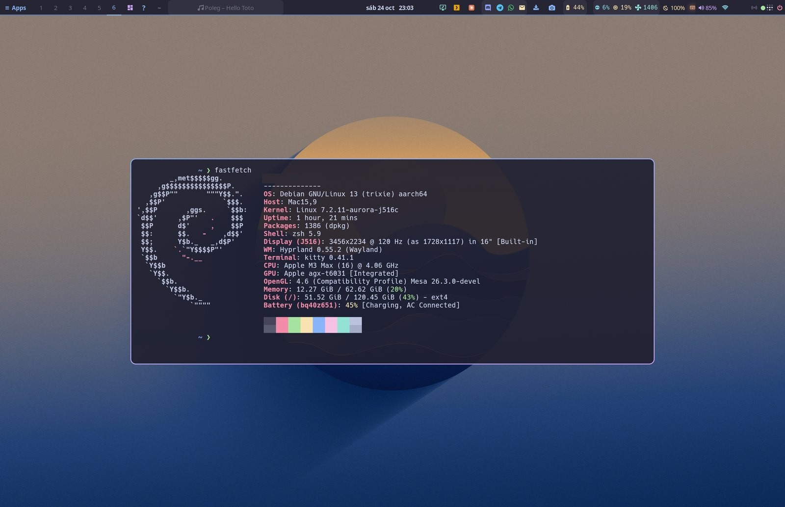
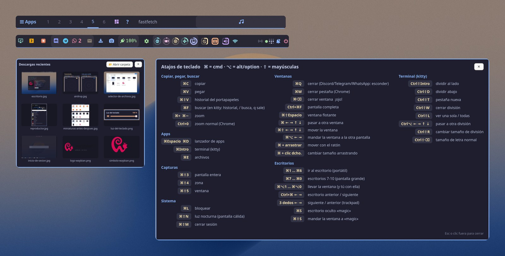
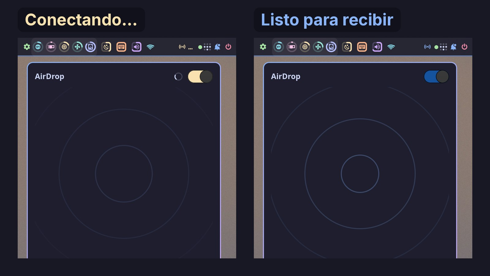
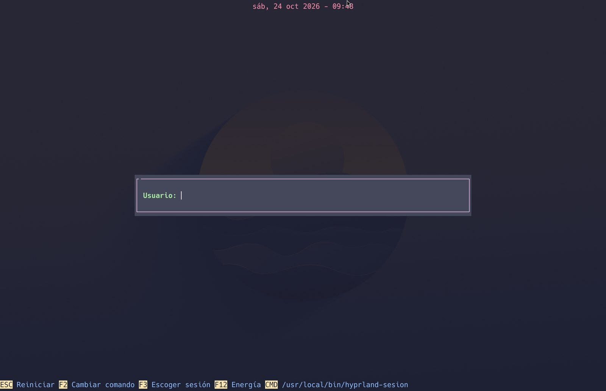
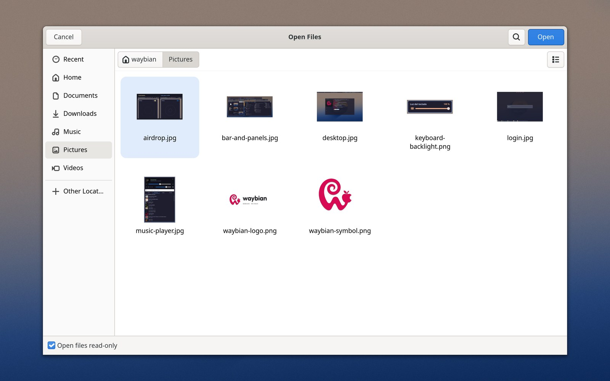
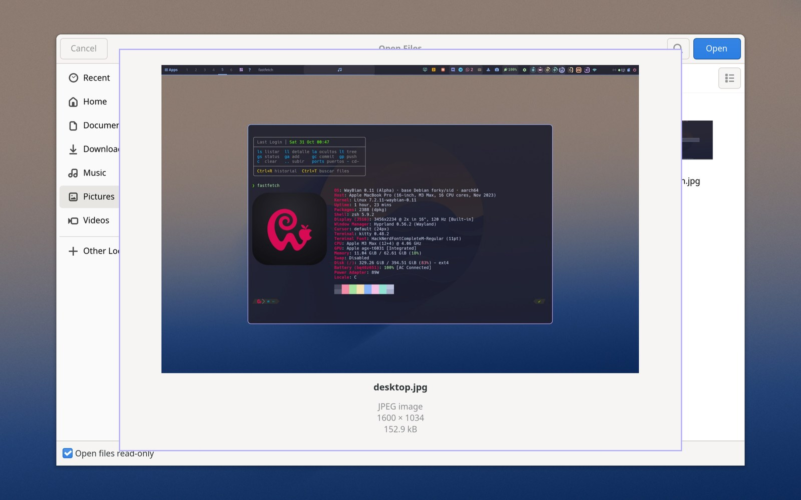

<p align="center">
  <picture>
    <source media="(prefers-color-scheme: dark)" srcset="https://github.com/samucarre/waybian/raw/main/logo/waybian-logo-oscuro.png">
    <source media="(prefers-color-scheme: light)" srcset="https://github.com/samucarre/waybian/raw/main/logo/waybian-logo-claro.png">
    
  </picture>
</p>

# WayBian

**Debian 14 running natively on a MacBook Pro 16" M3 Max — Wayland desktop (Hyprland), GPU acceleration, Wi‑Fi, sound, AirDrop, external HDMI, dual boot with macOS.**

*Leer en español: [README.es.md](README.es.md).*

WayBian (Wayland + Debian) is a hand-assembled Debian system (Debian 14 "forky", the testing branch, since 27 Oct 2026; it started on Debian 13 "trixie") for the 2023 MacBook Pro 16" with the Apple M3 Max (Apple board `j516c`, SoC `t6031`). Nobody ships a ready-made Linux for this machine: Asahi Linux's M3 support (September 2026) is an initial kernel with no GPU driver and no distribution, and Debian's own Apple Silicon installer ("Bananas") only accepts M1/M2 firmware. WayBian puts the pieces together — Asahi's boot chain, the Aurora Silicon kernel and GPU driver, Debian's userland — and fixes what is missing in between.

This repository is the **presentation** of the project: what it is, how it works, what works and what does not, and which pieces were changed. It exists to share the result with people who want the same thing, and to learn from anyone who knows better. Issues and Discussions are open.

The day-to-day record (every change with its reason, a mirror of every configuration file, patches, and the scripts that rebuild the system from scratch) lives in a separate private repository, `waybian-lab`. Ask if you need something from it.

> **Status (30 Oct 2026):** alpha, in daily use as the author's main machine since 22 Oct 2026. Upgraded in place from Debian 13 to Debian 14 on 27 Oct 2026 after a rehearsal in a container (what broke and how it was fixed: [docs/software.md](docs/software.md#debian-14)). Kernel `7.2.11-waybian-0.9`. Expect rough edges.

## Repositories

WayBian is spread over several repositories; this one ties them together.

| Repository | What it is |
|---|---|
| **samucarre/waybian** (this one) | The presentation: what works and how, every change explained in [`docs/`](docs), screenshots, and the patches of every fork in [`patches/`](patches). |
| The forks: [Waybar](https://github.com/samucarre/Waybar) · [aquamarine](https://github.com/samucarre/aquamarine) · [Postcard](https://github.com/samucarre/postcard) · [omdrop-awdl](https://github.com/samucarre/omdrop-awdl) · [libva-v4l2_request](https://github.com/samucarre/libva-v4l2_request) · [xdg-desktop-portal-gtk4](https://github.com/samucarre/xdg-desktop-portal-gtk4) | The programs that needed a change, each in its own fork and branch. The [`forks/`](forks) folder links to each one at the exact commit running on the machine and explains it; what each one changes: [The pieces that were changed](#the-pieces-that-were-changed). |
| [samucarre/linux-aurora](https://github.com/samucarre/linux-aurora) | The public fork of Aurora's kernel tree (also in [`forks/`](forks), not downloaded by default), used to send kernel patches upstream: four pull requests to `omacom/linux-aurora`, open as of 29 Oct ([#258](https://github.com/omacom/linux-aurora/pull/258) GPU report to the power manager, [#259](https://github.com/omacom/linux-aurora/pull/259) J516C panel brightness, [#260](https://github.com/omacom/linux-aurora/pull/260) an AV1 decoding fix, [#261](https://github.com/omacom/linux-aurora/pull/261) more GPU jobs in flight). |
| The lab repository (private) | The day-to-day log, a mirror of every configuration file, and the scripts that rebuild the system from scratch. |
| The kernel fork (private) | Aurora's tree with local patches, configurations and install scripts ([docs/kernel-gpu.md](docs/kernel-gpu.md)). |

## The machine

| | |
|---|---|
| Model | MacBook Pro 16" (2023), `Mac15,9` |
| SoC | Apple M3 Max `t6031`: 16-core CPU (12P + 4E), 40-core GPU (G15C), 64 GB |
| Apple board id | `j516c` (`t6031-j516c.dts` in the kernel) |
| Storage | 1 TB SSD: macOS 27 on 521.5 GiB, Linux root 401.9 GiB (ext4), both on the same disk |
| Debian | 14 "forky" (testing), upgraded from 13 "trixie" on 27 Oct 2026 |
| Page size | 16 KiB (required by Apple's IOMMUs; some binaries assume 4 KiB) |

## What works

| Component | State | Notes |
|---|---|---|
| Dual boot with macOS | ✅ | Power on → Debian; hold the button → macOS. macOS untouched (its own APFS container, Full Security). |
| CPU, NVMe, memory | ✅ | 16 KiB pages. |
| **GPU** (G15C, 40 cores) | ✅ | Aurora Silicon's driver and Mesa. OpenGL 4.6 and Vulkan 1.4; the compositor uses ~2 % CPU. |
| Internal display 3456×2234 | ✅ | Scale 2 in Hyprland. **Brightness control** works (local kernel patch for this board). |
| Keyboard and keyboard backlight | ✅ | The M3 keyboard has no backlight keys: a panel widget drives it. |
| Trackpad | ✅ | Three-finger gestures switch workspaces. |
| Wi‑Fi (BCM4388) | ✅ | Firmware extracted from macOS by the installer (`vendorfw`); see [docs/hardware.md](docs/hardware.md) for the initramfs fixes it needed. |
| Bluetooth | ✅ | Audio and HID devices. |
| Speakers | ✅ | Asahi's DSP chain for the J516 (asahi-audio 5.0), `speakersafetyd` guarding them. |
| Headphone jack | ✅ | Output capped at −12 dB (the DAC otherwise reaches +12 dB). |
| Microphones | ✅ | Beamforming profile. |
| Camera | ✅ | `apple-isp`. |
| Battery, charging | ✅ | Time left from the SMC's own estimate. |
| USB‑C ports (USB 3) | ✅ | All three, with `deferred_probe_timeout=10` (the type‑C controllers wait for a USB4 driver that does not exist yet). |
| **HDMI output** | ✅ | External ultrawide at 3440×1440, 60 Hz, through a patched `aquamarine`. 100 Hz pending. |
| Hardware video decode (AVD) | ✅ | H.264 / HEVC / VP9 / AV1 through VA‑API (`libva-v4l2-request`): Chrome, mpv, GStreamer. Roughly 5 W less on a video page. |
| AirDrop | ✅ | Both directions with an iPhone, over the Wi‑Fi chip's AWDL (`omdrop`). |
| Suspend | 🟡 | Suspend-to-idle works when started by hand (`rtcwake`), **GPU included**, and the RTC alarm wakes the machine (kernel 0.9; three out of three in testing). Not wired to the lid yet: closing it still locks the session, and the battery drain while asleep is not measured yet. See [docs/hardware.md](docs/hardware.md#suspend). |
| Thunderbolt / USB4 | ❌ | No driver. |
| DisplayPort over USB‑C | ❌ | Investigated; needs kernel and boot-loader work. |
| Reading the macOS volume | ❌ | Hardware-encrypted APFS; files go through the network. |

Details per component, with the fixes that were needed: [docs/hardware.md](docs/hardware.md).

## How it boots

```
Power button
 └─ Boot ROM → iBoot (Apple, signed)                       untouched
     └─ APFS container "Debian" (stub, Permissive Security)   created by the Asahi installer
         └─ m1n1 stage 1 → ESP/m1n1/boot.bin (m1n1 stage 2 + device trees + U‑Boot)
             └─ U‑Boot (UEFI) → ESP/EFI/BOOT/BOOTAA64.EFI (GRUB)
                 └─ Linux (Aurora/Asahi kernel) + initramfs → Debian 14 → greetd → Hyprland
```

The Asahi installer is used in its **"UEFI environment only"** mode: it shrinks macOS, creates the stub container with macOS 14.8.3 firmware, installs m1n1 + U‑Boot and an ESP, and nothing else. Debian is written on top by hand. Debian's own `m1n1`, `u-boot-asahi` and `asahi-platform` packages are pinned out: they do not know the M3 and their post-install hook would overwrite `boot.bin` and leave the Mac unbootable. More in [docs/boot-chain.md](docs/boot-chain.md).

## Kernel and GPU

- **Kernel "WayBian 0.9"**: Aurora Silicon's `integration/aurora` branch (Linux 7.2.11, state of 29 Oct 2026) plus local patches (panel brightness on this board, external HDMI on the `apple-drm-ext` card, GPU stamp renumbering so that long GPU compute runs no longer hang the GPU, suspend ported from an open Aurora pull request for the M3 Pro, and the GPU kept powered through suspend), 16 KiB pages, with BTF and without SELinux, built locally. GRUB keeps Asahi's 7.1.13 as an emergency entry and the previous kernels as fallbacks; new kernels are tried once through `grub-reboot` before becoming the default (0.3 was the exception: GRUB ignored `next_entry` until its image was rebuilt).
- **GPU**: the M3 is a new GPU generation (G15) that Asahi does not drive yet. Before adopting Aurora's driver, the author ported an experimental driver for another M3 variant to the G15C up to stable compute jobs (33 debugging rounds in a day); the lessons are in [docs/kernel-gpu.md](docs/kernel-gpu.md). Today: "Apple M3 Max (G15C B2)", 40 cores in 4 clusters, OpenGL 4.6 and Vulkan 1.4, Hyprland with real acceleration.
- **Video decode**: the AVD firmware is free software (`aurora-silicon/avd-fw`), built locally and installed per kernel version.

## Desktop

Hyprland 0.56 on Wayland, with a workflow that keeps the habits of macOS:

- **Waybar ported to GTK4** (our fork of the upstream PR), with hand-written widgets: a one-click "workstation" layout, a recent-files panel with drag and drop, messaging counters (Discord, Telegram, WhatsApp, mail), remote desktops by groups, a Wi‑Fi panel that retries, a shortcuts cheat sheet, fans/temperatures/power, keyboard backlight, Tailscale, AirDrop and a small music player (Subsonic/Navidrome client playing through mpv; the bar button shows where the audio comes from, the player or a web page in Chrome).
- **macOS shortcuts**: ⌘C/⌘V/⌘X everywhere (translated to Ctrl+Shift in the terminal, where Ctrl+C interrupts; ⌘C/⌘X confirm what was copied with a notification), ⌘F, ⌘W, ⌘T, ⌘⏎, ⌘+/⌘−, Ctrl+⌘F for full screen; ⌘⇧3/4/5 screenshots with the floating thumbnail; three-finger gestures.
- **Night light** as a Hyprland shader driven by the local sunset (the display driver exposes no colour matrix yet), removed from screenshots afterwards.
- **AirDrop** to and from an iPhone, with a card you can drag from the moment the file arrives; photos are turned upright on arrival.
- **Login**: greetd with a minimal Hyprland greeter (wallpaper + translucent terminal), drawn by CPU so it works even without the GPU, falling back to the console if the graphics do not come up in 40 s.
- **Configuration in Lua**: Hyprland 0.56 warns that 0.57 drops the `.conf` format, so the configuration is Lua now; a small `hyprctl` wrapper translates over 60 old-style dispatchers and any configuration keyword, so the scripts, the bar and the idle daemon keep working.
- **GTK4 everywhere**: Nautilus, file dialogs through a GTK4 portal built from our fork with **Quick Look** (space bar on a file, like the Finder) and thumbnails made ahead of time, Chrome with its GTK4 backend, fuzzel, satty, and **Postcard** as the mail client (built from our fork against Debian 14's GTK 4.24 and libadwaita 1.10, on the system Python 3.14).

More, with the reasons behind each choice: [docs/desktop.md](docs/desktop.md). The full software inventory (what is packaged, what we build ourselves, what draws with the GPU and why GTK4): [docs/software.md](docs/software.md).

<p align="center">
  <br>
  <sub>The desktop, with the system information panel.</sub>
</p>
<p align="center">
  <br>
  <sub>The bar and some of its panels.</sub>
</p>
<p align="center">
  
  <br>
  <sub>AirDrop from an iPhone · the login screen.</sub>
</p>
<p align="center">
  
  <br>
  <sub>The open dialog with its thumbnails, and Quick Look after pressing space (the files are screenshots of WayBian).</sub>
</p>

## Software

The rule for choosing software: whatever is on screen should be drawn by the GPU, not the CPU, which is what drains the battery. So: Wayland-native and GTK4 first; otherwise a toolkit that still renders on the GPU; Electron only when there is nothing else. Full inventory with notes: [docs/software.md](docs/software.md).

**Desktop**

| Program | Role | Draws with | Origin |
|---|---|---|---|
| Hyprland 0.56 | compositor | OpenGL | Debian 14 |
| aquamarine (patched) | DRM/GBM backend | — | **built from our fork** |
| Waybar (GTK4 port) | bar and widgets | GTK4 (Vulkan) | **built from our fork** |
| fuzzel · mako · swaybg | launcher · notifications · wallpaper | Wayland native | Debian 14 |
| kitty 0.48 | terminal | OpenGL | Debian 14 |
| greetd + tuigreet + own greeter | login | CPU on purpose | Debian 14 + ours |
| hyprlock · hypridle · hyprpicker · hyprpolkitagent | lock, idle, picker, polkit | OpenGL / Wayland | Debian 14 |
| grim · slurp · satty | screenshots, annotation | satty: GTK4 | Debian 14 · satty upstream binary |
| xdg-desktop-portal-hyprland · portal-gtk4 | portals, file dialogs with Quick Look | GTK4 (Rust) | Debian 14 · **built from our fork** |
| Nautilus 51 · Loupe 51 · sushi 50 | files, images, Quick Look | GTK4 + libadwaita | Debian 14 |
| pavucontrol 6 | audio mixer | GTK4 | Debian 14 |
| PipeWire · WirePlumber · asahi-audio · speakersafetyd | sound | — | Debian 14 + Asahi |
| NetworkManager + iwd | network | — | Debian 14 |
| ~30 own panels and tools | recent files, messaging, remote desktops, Wi‑Fi, keyboard light, AirDrop, music, night light… | Python + GTK4 | ours |

**Applications**

| Program | Draws with | Origin |
|---|---|---|
| Google Chrome | Chromium, GTK4 dialogs (`--gtk-version=4`), hardware video decode | vendor repo |
| Postcard (mail) | GTK 4.24 + libadwaita 1.10 + WebKitGTK, Python 3.14 | **built from our fork** |
| WordCraft · GridCraft · DeckCraft · PdfCraft · PhotoCraft | Rust (iced) on Vulkan | upstream releases |
| LibreOffice | GTK3, headless only, hidden from the menu: the tool the AI assistant (Claude Code) uses to build and convert Office files, because the Craft apps' MCP servers are not mature enough for it yet; also opens legacy .xls/.ppt/.odp | Debian 14 |
| mpv 0.41 | OpenGL/Vulkan, `hwdec` | Debian 14 |
| Telegram Desktop 5.7 | Qt 5 + Vulkan | Debian 14 |
| WhatsApp | Chrome app window | — |
| Vesktop (Discord) · Claude Desktop | Electron (GTK3) | upstream |
| Remmina 1.4 | GTK3 | Debian 14 |
| Steam · Tailscale · Claude Code | — | upstream |

**Built by us, not from apt:** Waybar GTK4, aquamarine, libva-v4l2_request, Postcard, xdg-desktop-portal-gtk4, Aurora's Mesa, the AVD firmware and the kernel. Still not GTK4: the Electron apps (Electron ignores the flag), LibreOffice (its GTK4 backend crashes) and Remmina (no port).

## The pieces that were changed

Every program that needed a change has a fork with its own branch, so the system can be rebuilt without waiting for upstream:

| Program | Fork / branch | What changed |
|---|---|---|
| Waybar | [samucarre/Waybar](https://github.com/samucarre/Waybar) `gtk4-debian13-m3` | GTK4 port (upstream PR Alexays/Waybar#5366) + fixes: a segfault in `hyprland/workspaces`, module menus, surviving monitor hot-plug, `align` for custom modules, workspace clicks with Hyprland's Lua configuration |
| aquamarine | [samucarre/aquamarine](https://github.com/samucarre/aquamarine) `hdmi-apple-drm-ext-0.15` | GBM renderer for a DRM card without a render node (the M3's HDMI path) |
| omdrop-awdl | [samucarre/omdrop-awdl](https://github.com/samucarre/omdrop-awdl) `discoverable-rapido` | faster discoverable on/off from the bar |
| Postcard | [samucarre/postcard](https://github.com/samucarre/postcard) `debian13-m3` | Google OAuth with a stored refresh token (no GNOME Online Accounts), IMAP IDLE on Python < 3.14, an iCloud `SEARCH ALL` quirk, a "group conversations" switch, a WebKit sandbox fix for a non-Mesa GL driver, build recipe for Debian 13 (on Debian 14 the system GTK and Python are enough) |
| libva-v4l2_request | [samucarre/libva-v4l2_request](https://github.com/samucarre/libva-v4l2_request) | mirror (VA‑API driver for the AVD) |
| xdg-desktop-portal-gtk4 | [samucarre/xdg-desktop-portal-gtk4](https://github.com/samucarre/xdg-desktop-portal-gtk4/tree/waybian) `waybian` | Quick Look in the GTK4 open dialogs (space bar, like the Finder) |
| Kernel | private fork of Aurora's tree | local patches, configs and install scripts; four of the patches are proposed upstream from the public fork [samucarre/linux-aurora](https://github.com/samucarre/linux-aurora) (pull requests #258–#261); see [docs/kernel-gpu.md](docs/kernel-gpu.md) |

The forks are mounted as git submodules under [`forks/`](forks) (each pinned to the exact commit running on the machine), and every code commit of ours is also readable as a patch file under [`patches/`](patches). Full list, bases and recipes: [docs/forks.md](docs/forks.md).

## How it was built

Kernel and root filesystem were built in an arm64 Linux VM, tested in QEMU with the same UEFI → GRUB → kernel path, then written to the Mac from macOS. After that, every change was made on the live machine and recorded. Reproducing the system is a matter of running the base scripts once and an idempotent `aplicar.sh` script afterwards — see [docs/reproduce.md](docs/reproduce.md). The whole thing was done with an AI coding assistant as copilot (Claude Code): the author decides what and why, the assistant reads logs, writes the scripts and tests; every kernel, boot-loader or GRUB change is explained first and always has a way back.

## Known issues and what we would love help with

- Suspend on lid close (suspend itself works since kernel 0.9; its battery drain is not measured yet), USB4/Thunderbolt and DisplayPort over USB‑C: not there yet.
- HDMI at 100 Hz (the panel/cable support it; the display path currently negotiates 60 Hz).
- GPU preemption: Aurora's G15 driver does not interrupt compute work yet, so while a long GPU compute job runs the desktop waits for each of its submissions and freezes.
- Anything you know about `t6031`/G15 that we got wrong.

Open an [issue](../../issues) or start a [discussion](../../discussions).

## Credits

[Asahi Linux](https://asahilinux.org) (m1n1, U‑Boot, the installer, the kernel work, `asahi-audio`, `speakersafetyd`), [Aurora Silicon](https://github.com/aurora-silicon) (M3 kernel integration, GPU driver and Mesa), [Debian](https://www.debian.org), [Fedora Asahi Remix](https://fedora-asahi-remix.org) (kernel configuration), [Hyprland](https://hyprland.org), [Waybar](https://github.com/Alexays/Waybar), [omdrop](https://github.com/netmojo-systems/omdrop-awdl), [Postcard](https://github.com/gxanshu/postcard) and everyone whose reverse engineering makes Linux on Apple Silicon possible.

## License

The texts and images of this repository are under [CC BY-NC 4.0](LICENSE): you can share and adapt them for non-commercial purposes, crediting "Samuel Carreño, WayBian" with a link here; any commercial use needs the author's permission first. The patches in [`patches/`](patches) keep the license of the program they apply to, and the forks keep their upstream licenses.
