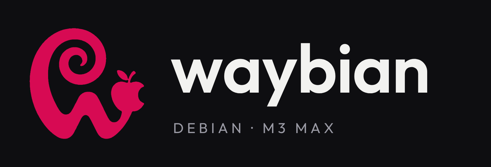

<p align="center">
  
</p>

# WayBian

**Debian 13 running natively on a MacBook Pro 16" M3 Max — Wayland desktop (Hyprland), GPU acceleration, Wi‑Fi, sound, AirDrop, external HDMI, dual boot with macOS.**

*Leer en español: [README.es.md](README.es.md).*

WayBian (Wayland + Debian) is a hand-assembled Debian 13 "trixie" system for the 2023 MacBook Pro 16" with the Apple M3 Max (Apple board `j516c`, SoC `t6031`). Nobody ships a ready-made Linux for this machine: Asahi Linux's M3 support (September 2026) is an initial kernel with no GPU driver and no distribution, and Debian's own Apple Silicon installer ("Bananas") only accepts M1/M2 firmware. WayBian puts the pieces together — Asahi's boot chain, the Aurora Silicon kernel and GPU driver, Debian's userland — and fixes what is missing in between.

This repository is the **presentation** of the project: what it is, how it works, what works and what does not, and which pieces were changed. It exists to share the result with people who want the same thing, and to learn from anyone who knows better. Issues and Discussions are open.

The day-to-day record (every change with its reason, a mirror of every configuration file, patches, and the scripts that rebuild the system from scratch) lives in a separate private repository, `waybian-lab`. Ask if you need something from it.

> **Status (27 Oct 2026):** alpha, in daily use as the author's main machine since 22 Oct 2026. Kernel `7.2.11-waybian-0.2`. Expect rough edges.

## The machine

| | |
|---|---|
| Model | MacBook Pro 16" (2023), `Mac15,9` |
| SoC | Apple M3 Max `t6031`: 16-core CPU (12P + 4E), 40-core GPU (G15C), 64 GB |
| Apple board id | `j516c` (`t6031-j516c.dts` in the kernel) |
| Storage | 1 TB SSD: macOS 27 on ~800 GiB, Linux root 122.5 GiB (ext4), both on the same disk |
| Page size | 16 KiB (required by Apple's IOMMUs; some binaries assume 4 KiB) |

## What works

| Component | State | Notes |
|---|---|---|
| Dual boot with macOS | ✅ | Power on → Debian; hold the button → macOS. macOS untouched (its own APFS container, Full Security). |
| CPU, NVMe, memory | ✅ | 16 KiB pages. |
| **GPU** (G15C, 40 cores) | ✅ | Aurora Silicon's driver and Mesa. OpenGL 4.6; the compositor uses ~2 % CPU. |
| Internal display 3456×2234 | ✅ | Scale 2 in Hyprland. **Brightness control** works (local kernel patch for this board). |
| Keyboard and keyboard backlight | ✅ | The M3 keyboard has no backlight keys: a panel widget drives it. |
| Trackpad | ✅ | Three-finger gestures switch workspaces. |
| Wi‑Fi (BCM4388) | ✅ | Firmware extracted from macOS by the installer (`vendorfw`); see [docs/hardware.md](docs/hardware.md) for the initramfs fixes it needed. |
| Bluetooth | ✅ | Audio and HID devices. |
| Speakers | ✅ | Asahi DSP chain (same hardware as the M2 16"), `speakersafetyd` guarding them. |
| Headphone jack | ✅ | Output capped at −12 dB (the DAC otherwise reaches +12 dB). |
| Microphones | ✅ | Beamforming profile. |
| Camera | ✅ | `apple-isp`. |
| Battery, charging | ✅ | |
| USB‑C ports (USB 3) | ✅ | All three, with `deferred_probe_timeout=10` (the type‑C controllers wait for a USB4 driver that does not exist yet). |
| **HDMI output** | ✅ | External ultrawide at 3440×1440, 60 Hz, through a patched `aquamarine`. 100 Hz pending. |
| Hardware video decode (AVD) | ✅ | H.264 / HEVC / VP9 / AV1 through VA‑API (`libva-v4l2-request`): Chrome, mpv, GStreamer. Roughly 5 W less on a video page. |
| AirDrop | ✅ | Both directions with an iPhone, over the Wi‑Fi chip's AWDL (`omdrop`). |
| Suspend | ❌ | Not supported on M3 yet. Closing the lid locks the session instead. |
| Thunderbolt / USB4 | ❌ | No driver. |
| DisplayPort over USB‑C | ❌ | Investigated; needs kernel and boot-loader work. |
| Reading the macOS volume | ❌ | Hardware-encrypted APFS; files go through the network. |

Details per component, with the fixes that were needed: [docs/hardware.md](docs/hardware.md).

## How it boots

```
Power button
 └─ Boot ROM → iBoot (Apple, signed)                       untouched
     └─ APFS container "Debian" (stub, Permissive Security)   created by the Asahi installer
         └─ m1n1 stage 1 → ESP/m1n1/boot.bin (m1n1 stage 2 + device trees + U‑Boot)
             └─ U‑Boot (UEFI) → ESP/EFI/BOOT/BOOTAA64.EFI (GRUB)
                 └─ Linux (Aurora/Asahi kernel) + initramfs → Debian 13 → greetd → Hyprland
```

The Asahi installer is used in its **"UEFI environment only"** mode: it shrinks macOS, creates the stub container with macOS 14.8.3 firmware, installs m1n1 + U‑Boot and an ESP, and nothing else. Debian is written on top by hand. Debian's own `m1n1`, `u-boot-asahi` and `asahi-platform` packages are pinned out: they do not know the M3 and their post-install hook would overwrite `boot.bin` and leave the Mac unbootable. More in [docs/boot-chain.md](docs/boot-chain.md).

## Kernel and GPU

- **Kernel "WayBian 0.2"**: Aurora Silicon's `integration/aurora` branch (Linux 7.2.11, state of 26 Oct 2026) plus a handful of local patches (panel brightness on this board, external HDMI on the `apple-drm-ext` card, and a few fixes), 16 KiB pages, built locally. GRUB keeps Asahi's 7.1.13 as an emergency entry and the previous kernels as fallbacks; new kernels are always tried once through `grub-reboot` before becoming the default.
- **GPU**: the M3 is a new GPU generation (G15) that Asahi does not drive yet. Before adopting Aurora's driver, the author ported an experimental driver for another M3 variant to the G15C up to stable compute jobs (33 debugging rounds in a day); the lessons are in [docs/kernel-gpu.md](docs/kernel-gpu.md). Today: "Apple M3 Max (G15C)", 40 cores in 4 clusters, OpenGL 4.6, Hyprland with real acceleration.
- **Video decode**: the AVD firmware is free software (`aurora-silicon/avd-fw`), built locally and installed per kernel version.

## Desktop

Hyprland 0.55 on Wayland, with a workflow that keeps the habits of macOS:

- **Waybar ported to GTK4** (our fork of the upstream PR), with hand-written widgets: a one-click "workstation" layout, a recent-files panel with drag and drop, messaging counters (Discord, Telegram, WhatsApp, mail), remote desktops by groups, a Wi‑Fi panel that retries, a shortcuts cheat sheet, fans/temperatures/power, keyboard backlight, Tailscale, AirDrop and a small music player (Subsonic/Navidrome client playing through mpv).
- **macOS shortcuts**: ⌘C/⌘V/⌘X everywhere (translated to Ctrl+Shift in the terminal, where Ctrl+C interrupts), ⌘F, ⌘W, ⌘T, ⌘⏎, ⌘+/⌘−, Ctrl+⌘F for full screen; ⌘⇧3/4/5 screenshots with the floating thumbnail; three-finger gestures.
- **Night light** as a Hyprland shader driven by the local sunset (the display driver exposes no colour matrix yet), removed from screenshots afterwards.
- **AirDrop** to and from an iPhone, with a card you can drag from the moment the file arrives.
- **Login**: greetd with a minimal Hyprland greeter (wallpaper + translucent terminal), drawn by CPU so it works even without the GPU, falling back to the console if the graphics do not come up in 40 s.
- **GTK4 everywhere**: Nautilus with a GTK4 file portal, Chrome with its GTK4 backend, fuzzel, satty, and **Postcard** as the mail client (built against GTK 4.20 + libadwaita 1.8 in a private prefix, running on Python 3.15).

More, with the reasons behind each choice: [docs/desktop.md](docs/desktop.md).

<p align="center">
  <br>
  <sub>The desktop, with the system information panel.</sub>
</p>
<p align="center">
  <br>
  <sub>The bar and some of its panels.</sub>
</p>
<p align="center">
  
  <br>
  <sub>AirDrop from an iPhone · the login screen.</sub>
</p>

## The pieces that were changed

Every program that needed a change has a fork with its own branch, so the system can be rebuilt without waiting for upstream:

| Program | Fork / branch | What changed |
|---|---|---|
| Waybar | [samucarre/Waybar](https://github.com/samucarre/Waybar) `gtk4-debian13-m3` | GTK4 port (upstream PR Alexays/Waybar#5366) + fixes: a segfault in `hyprland/workspaces`, module menus, surviving monitor hot-plug, `align` for custom modules |
| aquamarine | [samucarre/aquamarine](https://github.com/samucarre/aquamarine) `hdmi-apple-drm-ext` | GBM renderer for a DRM card without a render node (the M3's HDMI path) |
| omdrop-awdl | [samucarre/omdrop-awdl](https://github.com/samucarre/omdrop-awdl) `discoverable-rapido` | faster discoverable on/off from the bar |
| Postcard | [samucarre/postcard](https://github.com/samucarre/postcard) `debian13-m3` | Google OAuth with a stored refresh token (no GNOME Online Accounts), IMAP IDLE on Python < 3.14, an iCloud `SEARCH ALL` quirk, a "group conversations" switch, a WebKit sandbox fix for a non-Mesa GL driver, build recipe for Debian 13 |
| libva-v4l2_request | [samucarre/libva-v4l2_request](https://github.com/samucarre/libva-v4l2_request) | mirror (VA‑API driver for the AVD) |
| xdg-desktop-portal-gtk4 | [samucarre/xdg-desktop-portal-gtk4](https://github.com/samucarre/xdg-desktop-portal-gtk4) | mirror (GTK4 file dialogs for Hyprland) |
| Kernel | private fork of Aurora's tree | local patches, configs and install scripts; see [docs/kernel-gpu.md](docs/kernel-gpu.md) |

Full list and recipes: [docs/forks.md](docs/forks.md).

## How it was built

Kernel and root filesystem were built in an arm64 Linux VM, tested in QEMU with the same UEFI → GRUB → kernel path, then written to the Mac from macOS. After that, every change was made on the live machine and recorded. Reproducing the system is a matter of running the base scripts once and an idempotent `apply` script afterwards — see [docs/reproduce.md](docs/reproduce.md). The whole thing was done with an AI coding assistant as copilot (Claude Code): the author decides what and why, the assistant reads logs, writes the scripts and tests; every kernel, boot-loader or GRUB change is explained first and always has a way back.

## Known issues and what we would love help with

- Suspend, USB4/Thunderbolt and DisplayPort over USB‑C: not there yet.
- HDMI at 100 Hz (the panel/cable support it; the display path currently negotiates 60 Hz).
- Anything you know about `t6031`/G15 that we got wrong.

Open an [issue](../../issues) or start a [discussion](../../discussions).

## Credits

[Asahi Linux](https://asahilinux.org) (m1n1, U‑Boot, the installer, the kernel work, `asahi-audio`, `speakersafetyd`), [Aurora Silicon](https://github.com/aurora-silicon) (M3 kernel integration, GPU driver and Mesa), [Debian](https://www.debian.org), [Fedora Asahi Remix](https://fedora-asahi-remix.org) (kernel configuration), [Hyprland](https://hyprland.org), [Waybar](https://github.com/Alexays/Waybar), [omdrop](https://github.com/omdrop), [Postcard](https://github.com/gxanshu/postcard) and everyone whose reverse engineering makes Linux on Apple Silicon possible.

## License

Not decided yet. The documentation and scripts in this repository are the author's; the forks keep their upstream licenses. If you want to reuse something, ask.
