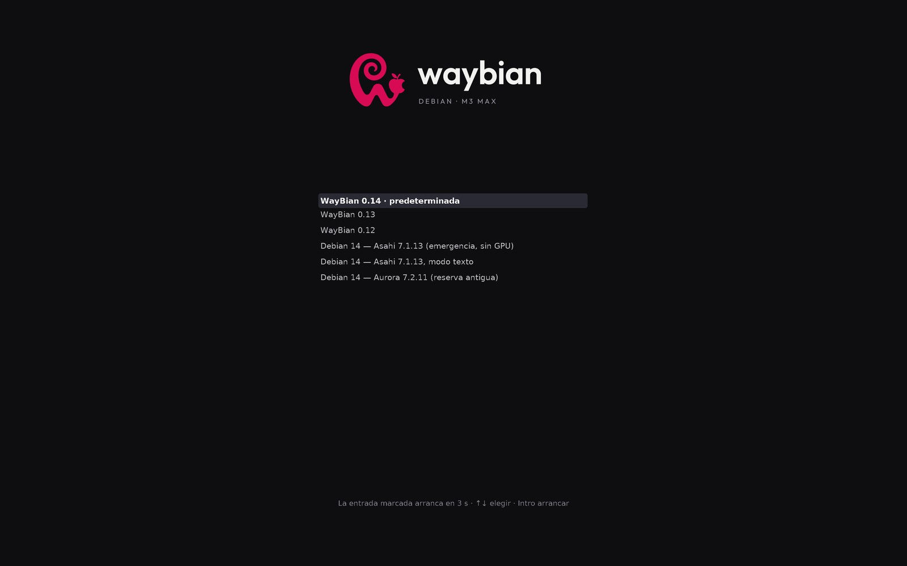

# Boot chain

How WayBian starts, what the installer creates on the disk, and why none of it touches macOS.

## The chain

```
Power button
 └─ Boot ROM → iBoot1 (Apple, signed)                                  never touched
     └─ picks an APFS container (the startup selector)
         ├─ macOS (Full Security)                                      never touched
         └─ "Debian": a stub APFS container in Permissive Security
             └─ iBoot2 + macOS 14.8.3 firmware (from the stub)
                 └─ m1n1 stage 1 (signed with a key local to this Mac)
                     └─ ESP/m1n1/boot.bin = m1n1 stage 2 + device trees + U‑Boot
                         └─ U‑Boot (UEFI, 3 s menu) → ESP/EFI/BOOT/BOOTAA64.EFI = GRUB
                             └─ Linux kernel + initramfs on the ext4 root → systemd → greetd → Hyprland
```

Power on with nothing pressed boots Debian (the installer set it as default). Holding the power button shows Apple's startup selector, where macOS is one click away.

## What the Asahi installer put on the disk

The official Asahi installer supports this board (`j516cap`) since 15 Sep 2026 and offers **"UEFI environment only (m1n1 + U‑Boot + ESP)"**. That is the only thing it is used for. It:

1. shrinks the macOS APFS container (it left macOS ~875 GiB; macOS has 363.2 GiB since the Linux root was enlarged, last on 4 Nov 2026 ([hardware.md](hardware.md#storage)); a local Time Machine snapshot has to be deleted first or the container refuses to shrink by a single byte);
2. creates a **stub APFS container** (~2.5 GB) with a minimal macOS 14.8.3 that provides iBoot2 and the peripheral firmware, and installs m1n1 inside it as the "kernel";
3. creates an **ESP** (FAT32, ~500 MB) with `m1n1/boot.bin`, U‑Boot and `vendorfw/` (Wi‑Fi/Bluetooth/trackpad firmware extracted from macOS);
4. leaves free space for the Linux root.

Lowering the stub to Permissive Security happens in recoveryOS (1TR), with the owner's password, during the installer's second step. Security on Apple Silicon is per container, so macOS stays in Full Security with FileVault and updates working as before. Nothing in the system firmware is modified.

Debian itself was written afterwards from macOS: an ext4 image onto a new partition, GRUB into the ESP (`EFI/BOOT/BOOTAA64.EFI` with a `grub.cfg` that looks for the root by UUID). `boot.bin` and `vendorfw/` were left exactly as the installer made them.

## Undoing everything (from macOS)

1. `diskutil list` — identify the ESP, the Linux partition and the stub container.
2. `diskutil eraseVolume free free diskXsN` for the ESP and the Linux partition.
3. `diskutil apfs deleteContainer diskY` for the stub (this also removes the entry in the startup selector).
4. `diskutil apfs resizeContainer disk3 0` so macOS gets the space back.

Worst case (very unlikely, since the system firmware is never touched) is a DFU restore with Apple Configurator from another Mac. Keep a backup before installing.

## Pinned packages

Debian ships `m1n1`, `u-boot-asahi` and `asahi-platform`, built for M1/M2. Their post-install hook (`zz-update-m1n1`) regenerates `boot.bin` with a m1n1 that does not know the M3, which would leave the Mac unable to boot Linux. They are blocked with `apt-mark hold` plus an apt pin, and `/etc/default/update-m1n1` has `M1N1_UPDATE_DISABLED=1` as a second lock.

`boot.bin` is rebuilt by hand only when a new kernel brings new device trees (m1n1 + the kernel's DTBs + U‑Boot, gzip-concatenated), and the previous `boot.bin` is always kept next to it. Since 25 Oct 2026 it also carries the WayBian logo and a 3 s U‑Boot timeout. The current one ("F", 2 Nov 2026) is the same recipe with the device tree of kernel 0.13, which adds the line that lets the Wi‑Fi driver pass the country to the Broadcom firmware (Aurora #311) and describes the RTC alarm (#285); the previous one ("E") stays on the ESP as `m1n1/boot.bin.E`, the way back if F did not boot. Kernels 0.13 and 0.14 should also boot with E (not tried): the country would then not reach the firmware, and the kernel would describe the RTC alarm from Apple's ADT as before. The install script finds the ESP by its PARTUUID rather than by partition number: its first run stopped itself because the ESP had become `p5` when the root was merged on 28 Oct (partition numbers move whenever partitions are added or removed, as they did again on 4 Nov).

## GRUB layout

The entries live in `/etc/grub.d/40_custom`, each with its own `--id`, so `update-grub` (which runs whenever the grub packages are upgraded) rebuilds this menu instead of dropping it. `10_linux` and the other generators that add entries by themselves are disabled, and the default is chosen by id (`GRUB_DEFAULT="waybian-0.14"` in `/etc/default/grub.d/`), because indexes change when an entry is added.

Since 2 Nov 2026 the menu keeps the three latest WayBian kernels plus the fallbacks; 0.1–0.11 were removed with the install script's `deshacer` (the whole lineage is in [kernel-gpu.md](kernel-gpu.md#kernel-lineage)):

| Entry (id) | Kernel | Purpose |
|---|---|---|
| `waybian-0.14` (**default**) | `7.2.11-waybian-0.14` | Aurora of 2 Nov: 0.13 + the panel framebuffer fix (#325) |
| `waybian-0.13` | `7.2.11-waybian-0.13` | Aurora of 1 Nov + 21 local patches |
| `waybian-0.12` | `7.2.11-waybian-0.12` | 0.11 + the 1000-nit brightness ceiling |
| `asahi-7.1.13`, `asahi-7.1.13-texto` | Asahi `asahi` branch 7.1.13 (Fedora Asahi 16k config) | emergency, graphical or text mode: no GPU, but boots whatever happens |
| `aurora-j516c` | `7.2.11-aurora-j516c` | the first Aurora kernel, kept as an old fallback |

Kernels under test get entries of their own in the same way. Any new kernel is installed as a new entry and tried **once** with `grub-reboot` (`next_entry` in `grubenv`, by id): if it hangs, the next reboot returns by itself to the previous default. Only after checking GPU, display, audio and camera does it become `GRUB_DEFAULT`.

The GRUB image in the ESP (`EFI/BOOT/BOOTAA64.EFI`) was rebuilt on 27 Oct 2026 with GRUB 2.14 and the `loadenv` module. The one made for Debian 13 (GRUB 2.12) did not carry `loadenv`: one-shot boots worked while the hand-written menu loaded it with `insmod`, but with the menu generated by `update-grub` (27 Oct) `next_entry` was silently ignored and every boot went to the default. The previous image stays next to it as a way back.

**Theme.** Without a theme GRUB draws its menu as a text console in the top-left corner, with a frame, and a lower resolution is not an option: U‑Boot offers only one mode, a 3456×2160 framebuffer (not the panel's full 3456×2234). Since 2 Nov 2026 a WayBian gfxmenu theme (`/boot/grub/themes/waybian/`, set with `GRUB_THEME`) draws a dark background, the WayBian logo, the menu centred in DejaVu Sans fonts made with `grub-mkfont` (the selected entry in bold on a highlight band) and a countdown at the bottom. The 44 px font of 27 Oct (the stock one is tiny at 3456×2160) stays for GRUB's console, and Debian's own theme stays disabled: its background image showed an error in red for an instant. The titles were shortened to fit (`WayBian 0.14 · predeterminada`), and the install script writes new entries with a short title too. The size took a few reboots to settle (the first version, at twice the old size, 88 px, was far too large; the menu ended at 30 px) until a preview script took over: it builds a standalone GRUB with the theme and the real entries, boots it in QEMU (UEFI firmware, `virtio-gpu` at 3456×2160) and saves a screenshot once the menu is drawn, in about 10 s with KVM. Two theme gotchas: positions only work as percentages (a mixed `50%-600` put the logo off to the right), and the selection band can overlap the next entry: its corner pieces set its minimum height (twice their size), and it measures `item_height + 2·item_padding + 4` while entries are `item_height + item_spacing` apart, so `item_spacing` must be at least `2·item_padding + 4`.

<p align="center">
  <br>
  <sub>The real GRUB with the theme, captured in QEMU at the boot framebuffer's resolution, 3456×2160 (<code>previsualizar-grub.sh</code>).</sub>
</p>

Kernel command line, besides the root by UUID:

- `quiet loglevel=3` — the camera driver (`apple-isp`) dumps debug output on the console and would overwrite the login prompt.
- `appledrm.panel_nits_max=1000` — since kernel 0.12, raises the panel's brightness ceiling from 500 to 1000 nits (a local patch; see [hardware.md](hardware.md#display)).
- `firmware_class.path=/lib/firmware/vendor` — where the extracted Apple firmware lands; without it the Wi‑Fi and trackpad firmware are not found.
- `deferred_probe_timeout=10` — the USB‑C controllers (`cd321x`) wait for a USB4 driver that does not exist; the timeout lets USB 3 come up anyway.

## A boot without red lines

Even with `quiet loglevel=3`, three error lines showed up in red at every boot. The kernel was not printing them: **Plymouth**, in its details mode (no `splash`), read `/dev/kmsg` from the start and wrote every error in red on tty1 until it quit, just before greetd. It also lived inside the initramfs, so purging the package was not enough until the initrds were regenerated. Plymouth is gone. The errors themselves were harmless, and since `waybian-0.3` the kernel configuration removes two of them: **SELinux** is compiled out (Debian ships no policy, and systemd tried to disable it with a method the kernel no longer accepts), and the kernel carries **BTF**, which systemd needs to attach its BPF filesystem restrictions (`RestrictFileSystems=`). The third one is handled by a local patch.

## initramfs

Debian's initramfs uses klibc, and the upstream Asahi hook that unpacks `vendorfw/firmware.cpio` from the ESP assumed a shell with `cp`. Local hooks (`zz-asahi-m3`):

- copy `cp` into the initramfs and wait for the ESP's `/dev/disk/by-partuuid` link before mounting it;
- check `/vendorfw/.vendorfw.manifest` as upstream does (Debian's hook looked elsewhere) and log the result to `/var/log/asahi-vendorfw.log`;
- provide `/usr/bin/modprobe` — the Fedora kernel config hard-codes that path and Debian has it in `/usr/sbin`, so without the link the kernel could not autoload modules;
- keep `dockchannel-hid` (trackpad/keyboard) out of the initramfs, so it is not probed before its firmware exists. That driver does not survive an unbind/bind (kernel BUG), so it is never reloaded at runtime either.
