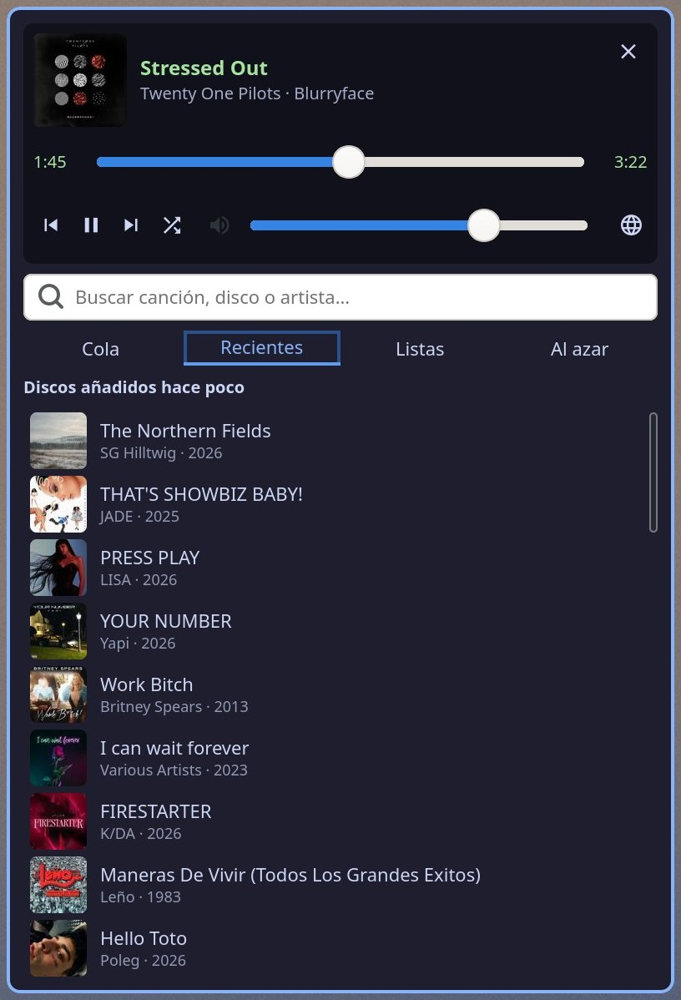
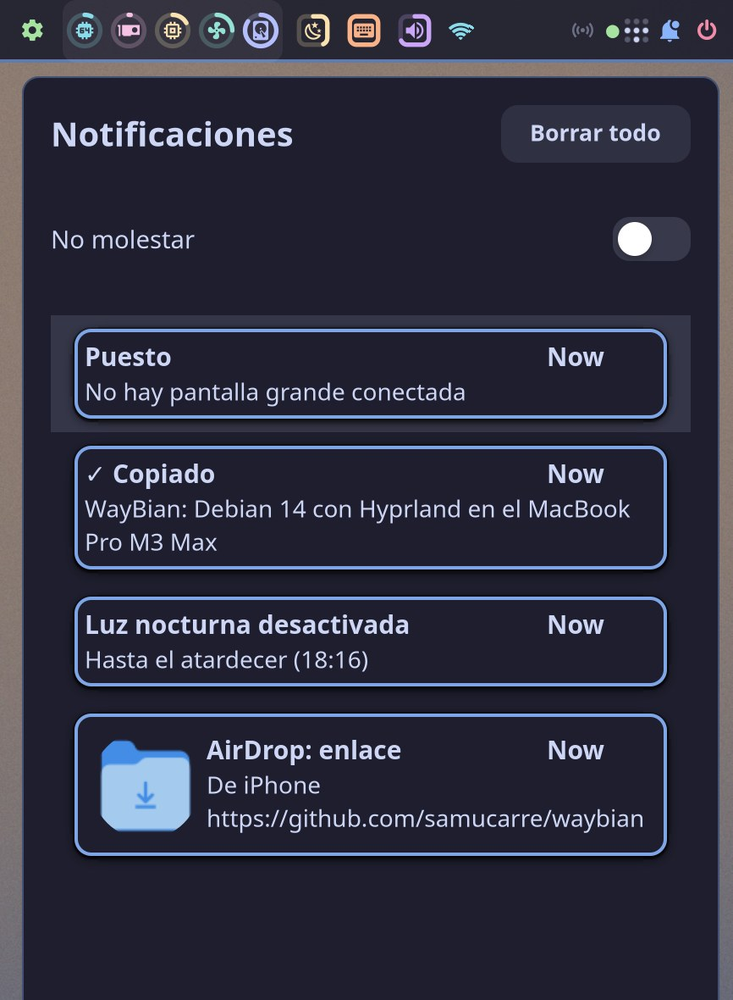
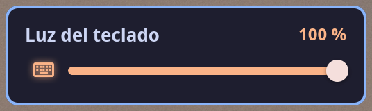
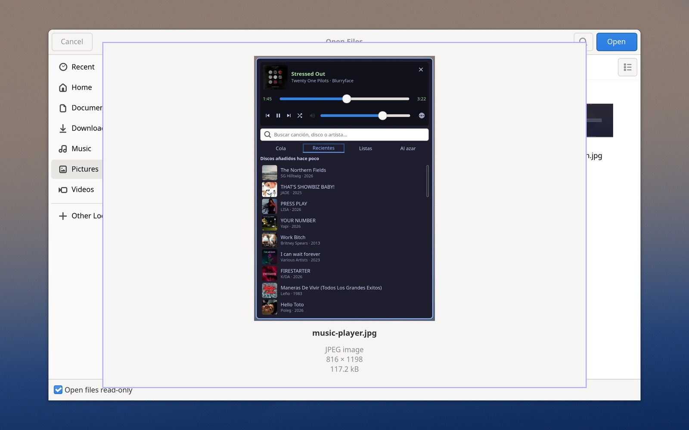

# Desktop

Hyprland 0.56 (Wayland) on Debian 14, with the tools and habits of a Mac user kept where they made sense.

## Session

- `greetd` on tty7 starting a **custom greeter**: a minimal Hyprland (its own user, software rendering) that shows the wallpaper dimmed and a translucent `kitty` with `tuigreet` in Spanish, remembering the user. If the graphical greeter does not appear within 40 s it falls back to the plain console greeter, so a broken GPU driver never locks you out. Tested with a fake greetd and a nested Hyprland before trusting it.
- The user session starts through a wrapper that picks the **GPU profile** when the Aurora driver is loaded and the **software profile** (`llvmpipe`, no blur/shadows) otherwise, and sets `AQ_DRM_DEVICES` with both DRM cards (internal panel + HDMI).
- Hyprland is **configured in Lua** (`hyprland.lua`): 0.56 shows a warning at every start that 0.57 removes the `.conf` format. With a Lua configuration, `hyprctl dispatch` and `hyprctl keyword` no longer take the old syntax that every script, the bar and the idle daemon used; a first attempt broke them all and was rolled back. A small wrapper in `/usr/local/bin/hyprctl` now translates over 60 legacy dispatchers and any configuration keyword into the Lua API (`workspace 2` → `hl.dsp.focus({ workspace = "2" })`), detects the mode once per Hyprland instance and passes everything through untouched when the configuration is a `.conf`. Waybar's Hyprland backend needed a fix of its own (see [forks.md](forks.md)).
- The desktop portal is started only when the Wayland socket exists: a program without a window that asked for it before login used to leave it hung, and at login the GTK4 bar waited for it. The bar's watchdog gives each attempt 40 s, more than a portal call takes to time out.
- Workspaces 1–6 on the laptop panel, 7–12 on the external monitor; `⌘⌥←/→` moves a window between screens. A "workstation" script lays out the usual windows in one click without duplicating the ones already open and without moving the user off the current workspace.

## Bar: Waybar on GTK4

Upstream Waybar is GTK3; the GTK4 port (upstream PR #5366) plus local fixes (a segfault in `hyprland/workspaces`, module menus, surviving monitor hot-plug, `align` for custom modules, workspace clicks with a Lua configuration) is built from the `samucarre/Waybar` fork. The panels that drop down from the bar are small Python + GTK4 programs; modules that change often are repainted on a signal instead of waiting for their interval. Widgets written for this system:

- **Workstation**: places every window on its workspace in one click.
- **Recent files**: thumbnails of the latest downloads and screenshots, draggable straight into a web page, a mail or a chat. With focus-follows-mouse the panel could not tell when you clicked outside to close it; it reads the click from the input device directly.
- **Messaging** with counters for Discord, Telegram, WhatsApp and mail, fed by D‑Bus notifications and reset when the app is looked at. Hiding is not closing: the window moves to a special workspace and keeps notifying.
- **Remote desktops** by groups, in equal columns, never duplicating open ones.
- **Wi‑Fi** panel that waits for the network to reappear and retries (see [hardware.md](hardware.md#wifi)).
- **Shortcuts cheat sheet** ("?").
- **Fans, temperatures and package power.** The fan icon broke the module's JSON when Waybar ran without a locale (`\U000F0210` as text); the glyph is emitted as raw bytes.
- **Notification centre** (`swaync`, GTK4; its own Waybar integration with our icons and colours): a bell next to the power button, grey when the panel is empty, blue with a dot while it holds notifications (until they are dismissed or cleared), purple and crossed out in Do Not Disturb. Click opens or closes the panel with the history (popups are no longer lost when they fade), right-click toggles Do Not Disturb. The bar module runs `swaync-client -swb`, which pushes every change, so the bell updates instantly instead of polling.
- **Keyboard backlight**, **AirDrop**, **Tailscale**, **night light**, and a **mini music player** (Subsonic/Navidrome client: cover, seek bar, search, queue, recent albums, playlists, shuffle; audio in a separate `mpv` process so the panel can close while the music goes on; the bar talks to `mpv`'s socket directly because the MPRIS bridge reported "stopped" while playing).
- The **music button** shows where the audio comes from: the mini player, or the site playing in Chrome (YouTube, Spotify, SoundCloud, Twitch…). Chrome gives no URL over MPRIS, so the site is worked out from the title of each Chrome window's active tab.
- On the laptop panel the bar is split around the notch: the left piece ends at the notch's edge, so the music box sits against it whatever the width of the window title; the clock, which fell under the notch, lives in the external monitor's bar.

   
  The mini music player: cover, seek bar, search, queue, recent albums, playlists, shuffle.

   
  The notification centre: the bell is blue while the panel holds notifications (these are test ones, with the texts WayBian's own scripts send).

   
  The keyboard backlight: the M3 keyboard has no keys for it, so a bar widget opens this slider.

## Mac habits

- **Shortcuts**: a small script (`atajo-mac`) receives `⌘`+key from Hyprland, looks at the active window's class and sends the equivalent with `sendshortcut`: ⌘C/⌘V/⌘X become Ctrl+C/V/X in applications and Ctrl+Shift+C/V in terminals (where Ctrl+C interrupts), ⌘F finds (history search in `kitty`), ⌘W closes a tab in the browser, ⌘T opens one, ⌘⏎ sends (Ctrl+⏎) in web apps and the mail client but opens a terminal from a terminal or an empty desktop, ⌘+/⌘− zoom, Ctrl+⌘F toggles full screen, ⌘L locks. Unassigned ⌘ keys would otherwise reach Chrome as plain letters. ⌘C and ⌘X confirm with a notification: ✓ with the beginning of what was copied, or ✗, naming the window the key went to, when nothing reached the clipboard.
- **Screenshots**: ⌘⇧3 screen, ⌘⇧4 area, ⌘⇧5 window (`grim`/`slurp`), with a draggable thumbnail at the bottom right that opens `satty` to annotate.
- **Trackpad**: three-finger swipes switch workspaces in the macOS direction; the MX Master's thumb buttons do the same.
- **Night light**: a Hyprland screen shader tinted according to the local sunset (NOAA solar equations), toggled with ⌘⇧N or automatically. Screenshots are un-tinted afterwards, so captures stay true to colour.
- **AirDrop**: `omdrop` over the Wi‑Fi chip's AWDL (`omdrop-awdl`; this board is the first M3 in its list). Receiving shows a card with a thumbnail that can be dragged from the first second; sending needs the iPhone's AirDrop sheet open. Early problems (opening the panel powered the radio twice, the receiver started before the AWDL interface existed, every click restarted the stack) were fixed in the integration scripts and verified with 40 rounds of random clicks. The receiver declares no HEIC support, so the iPhone sends JPEG. Those JPEGs carry an EXIF orientation tag that many viewers ignore, so they are rotated losslessly on arrival (`exiftran -ai`).
- **Quick Look**: space bar in the file manager (`sushi`) and in the open dialogs (see [File dialogs](#file-dialogs-thumbnails-and-quick-look)); HEIC thumbnails needed `heif-thumbnailer`.
- Same wallpaper as macOS, to make the dual boot feel like one machine.

## GTK4 everywhere

- File dialogs for Hyprland through a GTK4 portal (`xdg-desktop-portal-gtk4`, built from our fork for Quick Look), Nautilus, `fuzzel` as launcher, `satty`, `swaync` as notification centre (it replaced `mako`), `hypridle`/`hyprlock`, Chrome with `--gtk-version=4`. Electron apps, Thunderbird and LibreOffice cannot follow yet.
- **Mail: Postcard.** Upstream needs libadwaita ≥ 1.8 (`Adw.ShortcutsDialog`, which needs GTK ≥ 4.19.4) and Python ≥ 3.14 for its inbox watcher (`IMAP4.idle()`; the fork also speaks IDLE by hand on older Pythons). On Debian 13 (GTK 4.18, libadwaita 1.7, Python 3.13) it ran on GTK 4.20 + libadwaita 1.8 built into a private prefix and an official Python 3.15 build. Debian 14 ships GTK 4.24, libadwaita 1.10 and Python 3.14, so since 27 Oct 2026 it is built from the fork against the system (`/usr/local`), and the private prefix and Python 3.15 are gone. Two generic findings from the fork:
  - **iCloud IMAP answers `UID SEARCH ALL` from a stale index** that still lists messages moved or deleted long ago (129k UIDs for a mailbox of 119k). Any client that prunes its cache with `SEARCH ALL` keeps ghosts that open as "no message body". `UID SEARCH UID 1:*` (or `UNDELETED`) is exact, and faster.
  - iCloud does not push `EXISTS` to every idling session; a watcher that depends on IDLE alone can miss a message for the length of its IDLE period. Short IDLE periods with a cheap `SEARCH` after each one are the safe pattern.
- D‑Bus-activated services (Nautilus and whatever it launches) only see the environment passed with `dbus-update-activation-environment`; `DISPLAY` had to be added for Xwayland applications opened from the file manager.
- The session runs without `LANG`, so some apps appear in English; Spanish is set per application where it matters.

## File dialogs: thumbnails and Quick Look

The GTK4 file chooser (the "Open" dialog of Chrome and of every app that goes through the portal) had two gaps:

- **Thumbnails.** It only shows thumbnails that already exist in `~/.cache/thumbnails` (on GNOME, Nautilus creates them as it browses), it takes the largest size there is, and its grid stretches every thumbnail into a square, which distorts landscape and portrait pictures. A small user service (`miniaturas`: `inotifywait` + `glycin-thumbnailer`) creates them for Desktop, Pictures, Downloads and the dialog's bookmarks as soon as a picture appears, is renamed or is hard-linked, and stores them square with transparent padding; it also squares, in every size, the ones Nautilus makes.
- **Preview.** GTK 4 dropped the chooser's preview widget. Our fork of the portal ([samucarre/xdg-desktop-portal-gtk4](https://github.com/samucarre/xdg-desktop-portal-gtk4/tree/waybian), branch `waybian`) adds Quick Look as in the Finder: with the focus in the file list, space opens the selected file in its own window of 70 % × 80 % of the screen (an image is fitted inside and never enlarged; anything else shows its type icon), with name, type, size and, for images, dimensions; the arrows move to the previous or next file (only through the selected ones when there are several, keeping the selection), and space or Esc closes it, leaving the dialog's cursor on the file that was on screen so that Enter opens that one. For PNG, GIF, WebP and JPEG the image size is read from the file header first: above 40 megapixels the picture is decoded scaled down, above 100 not at all; nothing over 64 MiB is decoded. A review then found and fixed three bugs: an empty folder could crash the portal, closing the dialog with the preview open leaked the image, and Enter opened the file the preview had started from.

  
   
  The dialog's grid and Quick Look after pressing space (the files are screenshots of WayBian).

   
  Three files further with the arrow keys: a portrait image fitted in the same window.

   
  The same folder in the dialog's grid: plain GTK 4 (icons only), ordinary thumbnails (stretched) and the square ones.

