# Desktop

Hyprland 0.56 (Wayland) on Debian 14, with the tools and habits of a Mac user kept where they made sense.

## Session

- `greetd` on tty7 starting a **custom greeter**: a minimal Hyprland (its own user, software rendering) that shows the wallpaper dimmed and a translucent `kitty` with `tuigreet` in Spanish, remembering the user. If the graphical greeter does not appear within 40 s it falls back to the plain console greeter, so a broken GPU driver never locks you out. Tested with a fake greetd and a nested Hyprland before trusting it. Since a login screen stayed black on 2 Nov, the greeter's Hyprland logs to disk (`/var/lib/greetd/`, rotated at 1 MB and synced every second): holding the power key is a forced power-off without sync, and ext4's delayed allocation can keep the last ~35 s of writes in memory. In Hyprland 0.56.2 `debug:disable_logs` defaults to true and overrides `debug:enable_stdout_logs`, so a log needs both.
- The user session starts through a wrapper that picks the **GPU profile** when the Aurora driver is loaded and the **software profile** (`llvmpipe`, no blur/shadows) otherwise, and sets `AQ_DRM_DEVICES` with both DRM cards (internal panel + HDMI). It also keeps the whole session's Hyprland log, with timestamps, in `~/.local/state/` (Hyprland's stdout, flushed line by line), rotated at every login and kept for 14 days: the stock `hyprland.log` lives in `/run/user`, is lost at power-off and holds an 8 KB buffer that is not flushed.
- Hyprland is **configured in Lua** (`hyprland.lua`): 0.56 shows a warning at every start that 0.57 removes the `.conf` format. With a Lua configuration, `hyprctl dispatch` and `hyprctl keyword` no longer take the old syntax that every script, the bar and the idle daemon used; a first attempt broke them all and was rolled back. A small wrapper in `/usr/local/bin/hyprctl` now translates over 60 legacy dispatchers and any configuration keyword into the Lua API (`workspace 2` → `hl.dsp.focus({ workspace = "2" })`), detects the mode once per Hyprland instance and passes everything through untouched when the configuration is a `.conf`. Waybar's Hyprland backend needed a fix of its own (see [forks.md](forks.md)).
- The desktop portal is started only when the Wayland socket exists: a program without a window that asked for it before login used to leave it hung, and at login the GTK4 bar waited for it. The bar's watchdog gives each attempt 40 s, more than a portal call takes to time out.
- Workspaces 1–6 on the laptop panel, 7–12 on the external monitor; `⌘⌥←/→` moves a window between screens. A "workstation" script lays out the usual windows in one click without duplicating the ones already open and without moving the user off the current workspace.

## Bar: Waybar on GTK4

Upstream Waybar is GTK3; the GTK4 port (upstream PR #5366) plus local fixes (a segfault in `hyprland/workspaces`, module menus, surviving monitor hot-plug, `align` for custom modules, workspace clicks with a Lua configuration, tooltips and menus that hang from the bar) is built from the `samucarre/Waybar` fork. The panels that drop down from the bar are small Python + GTK4 programs on `gtk4-layer-shell` that share one module, `perfilado.py`; modules that change often are repainted on a signal instead of waiting for their interval.

**One shape for everything that hangs from the bar** (1–3 Nov 2026). On the laptop panel the bar is black, so the notch disappears into it, as TopNotch does on macOS; the external monitor's bar keeps its own colours. Panels, tooltips, menus, the notification centre and short notices hang from the bar's edge with no gap, in the colours of that screen's bar (on the external monitor the bar's blue bottom line carries on along the contour), with round bottom corners and two concave "ears" where they meet the bar. `perfilado.py` hangs a panel from its screen's bar, draws the ears with radial gradients, picks the theme from the output and runs the drawer animation (below). GTK 4 puts a tooltip 4 px below its widget and has no way to move it, so the fork draws its own (`util::Globo`: a popover without arrow, focus or input, offset to start exactly at the bar's edge, shown only while the pointer is really over the button), and module menus became the same kind of popover with a column of plain buttons. swaync takes no custom widgets, so its box and ears are layered CSS gradients, and its stylesheet is regenerated for the pointer's screen when the bell is clicked. On the laptop's bar every one-glyph button uses the Mono variant of the Nerd font (the proportional one starts glyphs at the left of their cell and lets them overflow on the right by 25–78 %), at a size per glyph that gives every icon the same 13 px of ink; measured on screenshots, every hover box is 40 physical px.

**The drawer.** Panels open like an elastic drawer: the content is drawn scaled vertically from the bar's edge (a `snapshot` scale with its origin at the top), so the top edge stays on the bar and only the body grows; neither the layout nor the surface changes. The curve takes the content from 12 % to full height in about 0.42 s (the first 60 % of a 0.7 s animation) with `cubic-bezier(.33,.9,.35,1)`. It first overshot to 105 % and came back, which showed on the panels (their surface is the panel's size, so the bottom edge was clipped and came back) but not in the notification centre (its scrolled window clips), so since 3 Nov the peak is 100 % everywhere; panels close at once. The same drawer, with the same constants, runs in three places: `perfilado.py` for the panels, `util::Cajon` in the Waybar fork for tooltips and menus (a C++ template that redraws a popover on a tick callback) and `src/cajon.vala` in our swaync fork for the control centre. All three move the animation's origin when two frames are more than 80 ms apart, so a stall delays the animation instead of skipping it: swaync's main loop stopped for ~510 ms right after mapping, while it created its windows for the other screens, and the centre jumped from 12 % to the end. Two traps: Hyprland fades layer surfaces in by itself, for about as long as the drawer grows, so the centre grew while still nearly transparent until it joined the panels in a `no_anim` layer rule; and in gtkmm a `snapshot_vfunc` override only runs when gtkmm registers a derived GType, which `Gtk::Popover` gets and `Gtk::PopoverMenu` (a wrapper around a GtkPopoverMenu created in C) does not, which is why the menus are plain popovers now.

Widgets written for this system:

- **Launcher**, hanging from the notch (⌘Space, ⌘D and the Apps button): search ignoring case and accents, several words, ↑↓ and Enter; applications sorted by use (its first run inherited fuzzel's counts) and started by Hyprland, terminal ones in kitty. fuzzel stays for the clipboard history (⌘⇧V).
- **Workstation**: places every window on its workspace in one click.
- **Recent files**: thumbnails of the latest downloads and screenshots, videos included (a frame with a play sign, from Nautilus's cache or `ffmpegthumbnailer`), draggable straight into a web page, a mail or a chat. With focus-follows-mouse the panel could not tell when you clicked outside to close it; it reads the click from the input device directly.
- **Messaging** with counters for Discord, Telegram, WhatsApp and mail, fed by D‑Bus notifications and reset when the app is looked at. Hiding is not closing: the window moves to a special workspace and keeps notifying. The count sits in a fixed one-digit slot next to each icon (a figure space when there is none, "+" above 9), so the buttons never move. Clicking a Telegram or Discord notification brings its window, which the app's own activation request cannot do here (Hyprland's `focus_on_activate` is off), and a small guardian on Hyprland's event socket hides the special workspace again whenever a focus change shows it over everything.
- **Remote desktops** by groups, in equal columns, never duplicating open ones.
- **Wi‑Fi** panel that waits for the network to reappear and retries (see [hardware.md](hardware.md#wifi)).
- **Shortcuts cheat sheet** ("?").
- **System** (4 Nov): one button replaces the five level rings the bar had for CPU, GPU, RAM, fans and SSD. Its icon is five small level bars in the rings' colours (the one past its threshold turns orange), an SVG whose file name carries the five levels, because the fork only repaints an icon when its path changes. A click drops a strip like a second bar, 44 px tall: the system's power (from the SMC) with an htop button, then a cell per metric with a ring, the figure and one line, and the full detail on hover (per-core load and clock and the top processes, GPU busy time, clock, power and jobs per second, memory and swap, fan speeds and temperatures, disk space and throughput). It stays until Escape (read from the input devices, so the key still reaches the active window) or another click on the button, and costs about 8 ms per second while open.
- **Brightness**: a slider in nits (25–1000), the normal range up to 500 and the extra range up to 1000 in orange ([hardware.md](hardware.md#display)). Dragging from the normal range stops at 500, and the extra range takes a second drag (keys and the wheel have no stop); above 500 the bar icon shows the excess in orange with a fixed orange halo, the "overload" state. Under the slider, the night light: a toggle (as ⌘⇧N, until the next sunrise or sunset) and three tones (5000, 4000 and 3400 K). A GTK 4 trap on the way: grouping a click gesture with `GtkRange`'s own made the slider stop following the mouse, and ungrouped it never received the release, so the release is detected by polling the pointer's button state every 60 ms.
- **Utilities** (3 Nov): tiles for Clocks, Dialect (a translator), Calculator and a colour picker (`hyprpicker`), plus a timer/stopwatch of our own whose time shows in the bar's button (green while running, yellow when paused, red for two minutes once the timer ends). The timer keeps timestamps in a file instead of a process in the background, and its alarm is a transient systemd user timer, which needs `AccuracySec=100ms`: with the default of one minute the alarm came up to a minute late. The three apps are Debian's GTK4 packages, opened as floating windows that come out of the bar like the panels. They get each bar's colours from a generated `gtk.css` and `ADW_DEBUG_COLOR_SCHEME=prefer-dark` (the global colour scheme would darken Chrome and every web page too). A normal window sits below the bar's layer, so a transparent layer surface without input draws the ears and a 2 px bridge over the bar's line; it is in place before the window appears, the bridge turns opaque at once and the ears fade in with the curve of Hyprland's own fade. Sliding the windows in clipped the header's text at the bar's edge (flickering white lines), so they use Hyprland's `gnomed` animation (a vertical scale from the window's centre) on a window twice as tall, centred on the bar's edge, with its content padded down by half: the visible half stretches down from the bar. Each tile opens a new window (the apps are single-instance, so each one starts in its own D‑Bus session; alarms of a Clocks opened that way do not reach the notification centre), cascading by 48 px, and Escape closes them through a non-consuming Hyprland bind.
- **Volume**: output and input cards (mute, a slider, the devices with the active one marked; a click makes another the default) and the full mixer one click away, kept live through `pactl subscribe`.
- **Power off**: lock, log out, restart and power off, hanging from the bar under ⏻.
- **Tailscale**: a switch, the exit node and the list of devices (a click copies an address). Panels with a switch take no keyboard and their switches cannot take focus: GTK focuses the first widget, and with on-demand keyboard focus a space or Enter typed while the panel was open once turned Tailscale off.
- **Fans, temperatures and power** now live in the System strip. Glyphs are emitted as raw bytes: the fan icon once broke a module's JSON when Waybar ran without a locale (`\U000F0210` as text).
- **Notification centre** (`swaync`, GTK4, built from our fork [samucarre/SwayNotificationCenter](https://github.com/samucarre/SwayNotificationCenter/tree/debian13-m3), branch `debian13-m3`; its own Waybar integration with our icons and colours): a bell next to the power button, grey when the panel is empty, blue with a dot while it holds notifications (until they are dismissed or cleared), purple and crossed out in Do Not Disturb. Click opens or closes the panel with the history (popups are no longer lost when they fade), right-click toggles Do Not Disturb. The bar module runs `swaync-client -swb`, which pushes every change, so the bell updates instantly instead of polling. The centre hangs from the bar against the right edge, 600 px tall instead of the whole screen's height, without the media player, and opens with the drawer.
- **"Copied"**: ⌘C and ⌘X confirm with a short notice that hangs from the notch like a tab (2 s, no focus; a new one replaces the previous) instead of a notification, so the centre does not fill up with them.
- **Keyboard backlight**, **AirDrop** (a panel hanging from the bar too), and a **mini music player** (Subsonic/Navidrome client: cover, seek bar, search, queue, recent albums, playlists, shuffle; audio in a separate `mpv` process so the panel can close while the music goes on; the bar talks to `mpv`'s socket directly because the MPRIS bridge reported "stopped" while playing). Its labels ellipsize with `max_width_chars=1`: a GTK 4 label's natural width is its whole text and a layer-shell window takes its content's natural width, so a long title widened the panel from 400 to about 700 px.
- The **music button** shows where the audio comes from: the mini player, or the site playing in Chrome (YouTube, Spotify, SoundCloud, Twitch…). Chrome gives no URL over MPRIS, so the site is worked out from the title of each Chrome window's active tab.
- On the laptop panel the bar is split around the notch: the left piece ends at the notch's edge, so the music box sits against it whatever the width of the window title; the clock, which fell under the notch, lives in the external monitor's bar.

  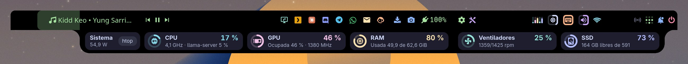 
  The System strip, fixed until Escape: power, CPU, GPU, RAM, fans and SSD, with the detail on hover.

  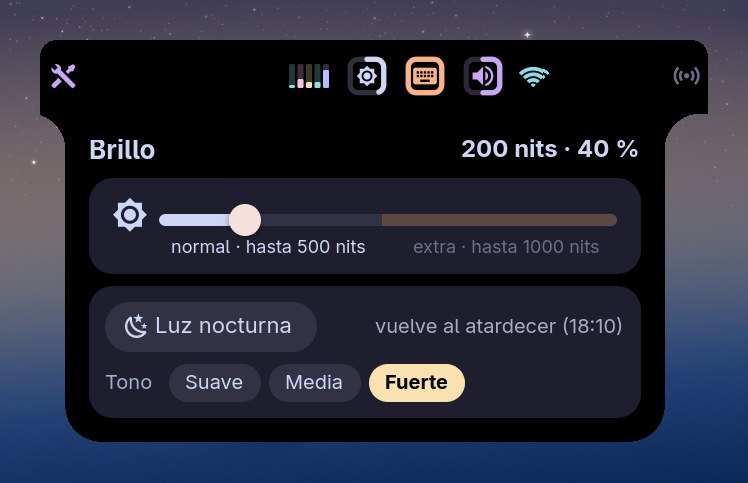
  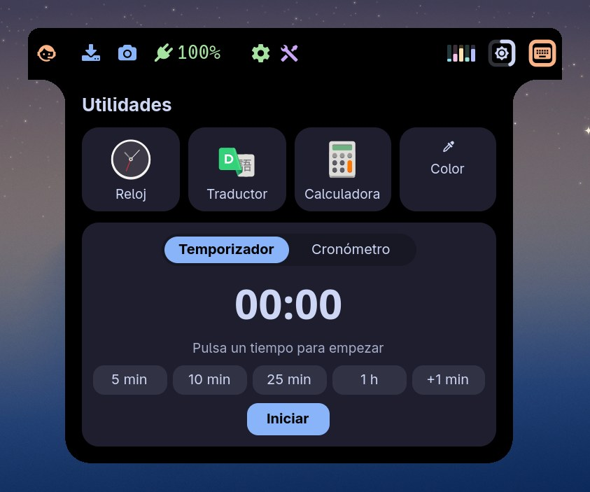 
  Brightness (normal up to 500 nits, extra up to 1000, and the night light) · Utilities, with the timer.

  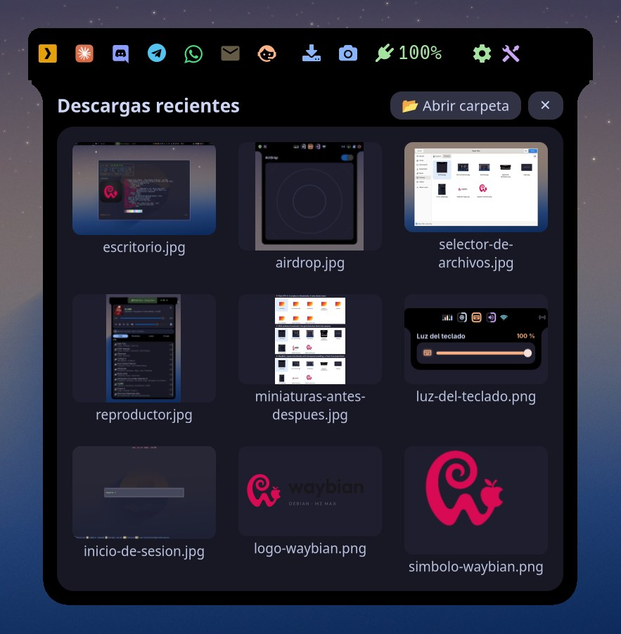
  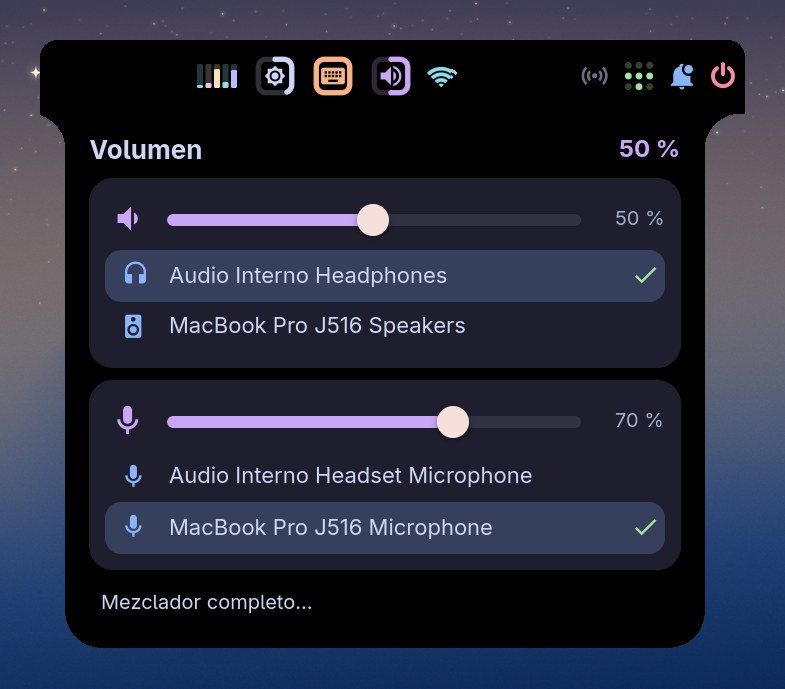 
  Recent downloads (here a demo folder with WayBian's own screenshots) · volume, with the outputs and inputs.

  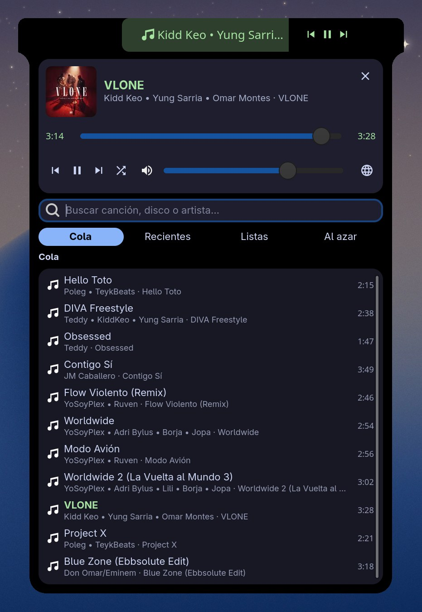 
  The mini music player: cover, seek bar, search, queue, recent albums, playlists, shuffle.

  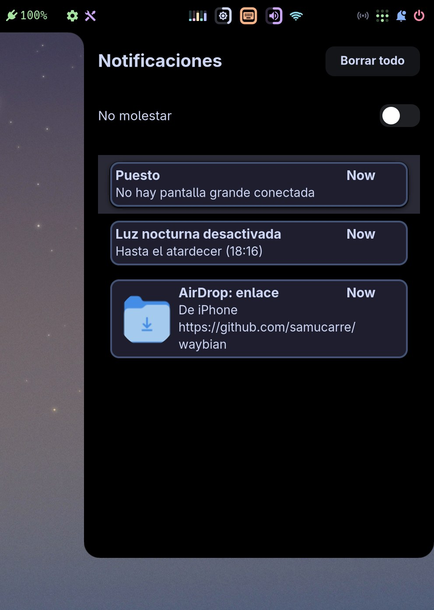 
  The notification centre: the bell is blue while the panel holds notifications (these are test ones, with the texts WayBian's own scripts send).

  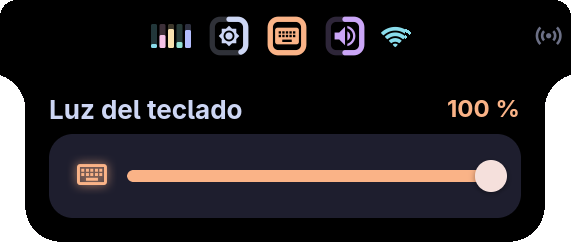 
  The keyboard backlight: the M3 keyboard has no keys for it, so a bar widget opens this slider.

## Mac habits

- **Shortcuts**: a small script (`atajo-mac`) receives `⌘`+key from Hyprland, looks at the active window's class and sends the equivalent with `sendshortcut`: ⌘C/⌘V/⌘X become Ctrl+C/V/X in applications and Ctrl+Shift+C/V in terminals (where Ctrl+C interrupts), ⌘F finds (history search in `kitty`), ⌘W closes a tab in the browser, ⌘T opens one, ⌘⏎ sends (Ctrl+⏎) in web apps and the mail client but opens a terminal from a terminal or an empty desktop, ⌘+/⌘− zoom, ⌘R reloads and ⌘A selects all (both do nothing in terminals, where Ctrl+R searches the history and Ctrl+A goes to the start of the line), Ctrl+⌘F toggles full screen, ⌘L locks (through `loginctl lock-session`, so it goes through hypridle and never starts a second hyprlock), and ⌘⇧R is the blind screen rescue ([hardware.md](hardware.md#lid-and-black-screens)). Unassigned ⌘ keys would otherwise reach Chrome as plain letters. ⌘C and ⌘X confirm with the notice that hangs from the notch: ✓ with the beginning of what was copied, or ✗, naming the window the key went to, when nothing reached the clipboard. In a terminal whose program keeps repainting the selected line (a spinner, say), kitty runs its copy action but the clipboard does not change, while the primary selection does hold the text; the script then copies the primary selection into the clipboard.
- **Screenshots**: ⌘⇧3 screen, ⌘⇧4 area, ⌘⇧5 window (`grim`/`slurp`), with a draggable thumbnail at the bottom right that opens `satty` to annotate.
- **Trackpad**: three-finger swipes switch workspaces in the macOS direction; the MX Master's thumb buttons do the same.
- **Night light**: a Hyprland screen shader tinted according to the local sunset (NOAA solar equations), toggled with ⌘⇧N, from the brightness panel or automatically. Screenshots are un-tinted afterwards, so captures stay true to colour.
- **AirDrop**: `omdrop` over the Wi‑Fi chip's AWDL (`omdrop-awdl`; this board is the first M3 in its list). Receiving shows a card with a thumbnail that can be dragged from the first second; sending needs the iPhone's AirDrop sheet open. Early problems (opening the panel powered the radio twice, the receiver started before the AWDL interface existed, every click restarted the stack) were fixed in the integration scripts and verified with 40 rounds of random clicks. The receiver declares no HEIC support, so the iPhone sends JPEG. Those JPEGs carry an EXIF orientation tag that many viewers ignore, so they are rotated losslessly on arrival (`exiftran -ai`). A restart of iwd once left the AWDL interface without its link-local address; iwd now ignores it ([hardware.md](hardware.md#wifi)).
- **Quick Look**: space bar in the file manager (`sushi`) and in the open dialogs (see [File dialogs](#file-dialogs-thumbnails-and-quick-look)); HEIC thumbnails needed `heif-thumbnailer`.
- **Wallpaper**: the same photo as macOS (by Martin Martz, on Unsplash), so that the dual boot feels like one machine, and since 1 Nov animated: the same picture, not a re-creation, with the waves inside its circle rocking and moving forward, in three loops chosen by the local sunset with the night light's equations: day (gulls, one of them flying out of the circle), evening from 90 minutes before sunset (the upper part darkens and stars twinkle) and night from 45 minutes after it (the same illustration by night, with silver crests and a moon). Each one is a seamless 20 s loop at 3456×2234 (H.264, 6–7 MB) generated with numpy and PIL. `mpvpaper` plays it with the AVD decoding (about 4 % CPU) and changes the loop through mpv's IPC without restarting. Animating cost about 4 W even behind windows (27.8 W against 23.6 W frozen, on battery), so it pauses while any window is active, moves only on an empty workspace and stops with the screen off or locked; if `mpvpaper` is missing or dies, `swaybg` puts the still photo back. The lock screen keeps the still photo.

  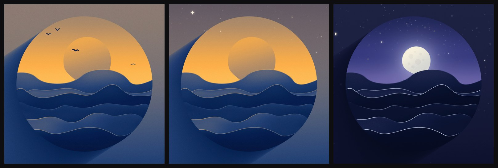 
  The three loops of the animated wallpaper: day (gulls), evening (stars) and night (the moon).

## GTK4 everywhere

- File dialogs for Hyprland through a GTK4 portal (`xdg-desktop-portal-gtk4`, built from our fork for Quick Look), Nautilus, the bar's own launcher (`fuzzel` only for the clipboard history), `satty`, `swaync` as notification centre (it replaced `mako`; built from our fork, and drawn on the GPU since 3 Nov), the Utilities apps (GNOME Clocks, Dialect, GNOME Calculator), `hypridle`/`hyprlock`, Chrome with `--gtk-version=4`. Electron apps, Thunderbird and LibreOffice cannot follow yet.
- **Mail: Postcard.** Upstream needs libadwaita ≥ 1.8 (`Adw.ShortcutsDialog`, which needs GTK ≥ 4.19.4) and Python ≥ 3.14 for its inbox watcher (`IMAP4.idle()`; the fork also speaks IDLE by hand on older Pythons). On Debian 13 (GTK 4.18, libadwaita 1.7, Python 3.13) it ran on GTK 4.20 + libadwaita 1.8 built into a private prefix and an official Python 3.15 build. Debian 14 ships GTK 4.24, libadwaita 1.10 and Python 3.14, so since 27 Oct 2026 it is built from the fork against the system (`/usr/local`), and the private prefix and Python 3.15 are gone. It wears kitty's palette (Catppuccin Mocha) through a user stylesheet that the fork loads at user priority, set on libadwaita's colour variables, translucent like the terminal with Hyprland's blur behind. Since 1 Nov the fork also draws `cid:` images inside the body (a mail that was only an embedded picture showed nothing: WebKit does not resolve `cid:`, and the reader's CSP only admits `data:` images), measures bodies that set `html, body {height:100%}` (the viewer read the 1 px it loads them at, and they stayed blank), keeps the composer's text readable in the dark scheme, survives the keyring daemon being replaced while it runs, and downloads the whole mailbox in the background instead of only the 50 newest messages per folder, so search covers everything: every header first (142,505 in 6 minutes), then every body from newest to oldest, with the bodies in a table of their own and the list read from the database in pages of 300. Generic findings from the fork:
  - **iCloud IMAP answers `UID SEARCH ALL` from a stale index** that still lists messages moved or deleted long ago (129k UIDs for a mailbox of 119k). Any client that prunes its cache with `SEARCH ALL` keeps ghosts that open as "no message body". `UID SEARCH UID 1:*` (or `UNDELETED`) is exact, and faster.
  - iCloud does not push `EXISTS` to every idling session; a watcher that depends on IDLE alone can miss a message for the length of its IDLE period. Short IDLE periods with a cheap `SEARCH` after each one are the safe pattern.
  - **A WebView taller than 16384 device pixels renders blank** (8192 logical px at scale 2: `Failed to create GBM buffer of size 2024x41792`): the GPU buffer cannot be that tall. The viewer stops growing there and the rest of the mail scrolls inside it.
  - **WebKit's `prefers-color-scheme` follows GTK's prefer-dark setting**, which libadwaita leaves untouched when the dark scheme comes from `ADW_DEBUG_COLOR_SCHEME` or from the portal, so the composer's editor styled with that media query believed it was in light mode (dark text on a dark card). It now gets a `dark` class from `Adw.StyleManager` and its colours from the widget's text colour and the accent colour.
  - **`gnome-keyring-daemon --replace` breaks running libsecret clients**: they keep a proxy to the old daemon's bus name and every lookup fails until they reconnect. In Postcard the sync thread died on that error with the account still marked as syncing, so every later sync was dropped as "already running"; the fork reconnects once and classifies the error.
- D‑Bus-activated services (Nautilus and whatever it launches) only see the environment passed with `dbus-update-activation-environment`; `DISPLAY` had to be added for Xwayland applications opened from the file manager.
- The session runs without `LANG`, so some apps appear in English; Spanish is set per application where it matters.

## File dialogs: thumbnails and Quick Look

The GTK4 file chooser (the "Open" dialog of Chrome and of every app that goes through the portal) had two gaps:

- **Thumbnails.** It only shows thumbnails that already exist in `~/.cache/thumbnails` (on GNOME, Nautilus creates them as it browses), it takes the largest size there is, and its grid stretches every thumbnail into a square, which distorts landscape and portrait pictures. A small user service (`miniaturas`: `inotifywait` + `glycin-thumbnailer`) creates them for Desktop, Pictures, Downloads and the dialog's bookmarks as soon as a picture appears, is renamed or is hard-linked, and stores them square with transparent padding; it also squares, in every size, the ones Nautilus makes.
- **Preview.** GTK 4 dropped the chooser's preview widget. Our fork of the portal ([samucarre/xdg-desktop-portal-gtk4](https://github.com/samucarre/xdg-desktop-portal-gtk4/tree/waybian), branch `waybian`) adds Quick Look as in the Finder: with the focus in the file list, space opens the selected file in its own window of 70 % × 80 % of the screen (an image is fitted inside and never enlarged; since 2 Nov, PDFs, videos and other files are rendered by the system's thumbnailers, and only a file without one shows its type icon), with name, type, size and, for images, dimensions; the arrows move to the previous or next file (only through the selected ones when there are several, keeping the selection), and space or Esc closes it, leaving the dialog's cursor on the file that was on screen so that Enter opens that one. For PNG, GIF, WebP and JPEG the image size is read from the file header first: above 40 megapixels the picture is decoded scaled down, above 100 not at all; nothing over 64 MiB is decoded. A review then found and fixed three bugs: an empty folder could crash the portal, closing the dialog with the preview open leaked the image, and Enter opened the file the preview had started from. The thumbnailers are the `*.thumbnailer` entries of the XDG data directories (papers for PDF, DjVu and comics, `ffmpegthumbnailer` for video, gdk-pixbuf for SVG): the preview asks for 2048 px into a private temporary directory and kills the process after 15 s or as soon as another file is chosen; a PDF previews in 0.08 s. Like the portal itself, and like Nautilus on this system, the thumbnailer runs without a bubblewrap sandbox.

  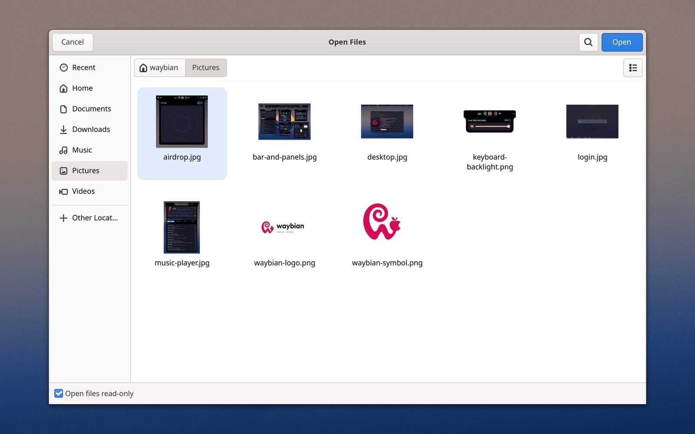
  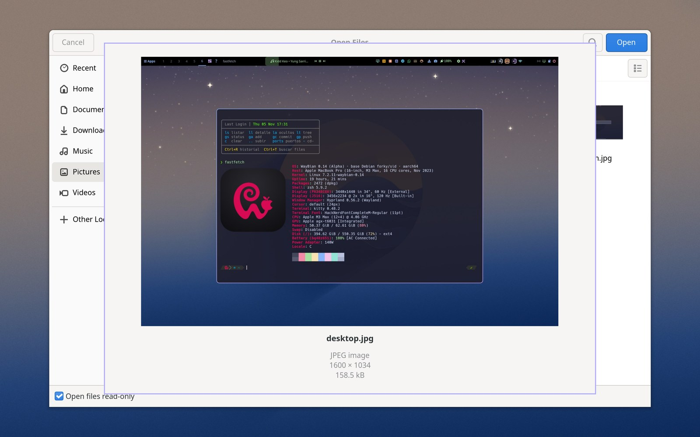 
  The dialog's grid and Quick Look after pressing space (the files are screenshots of WayBian).

  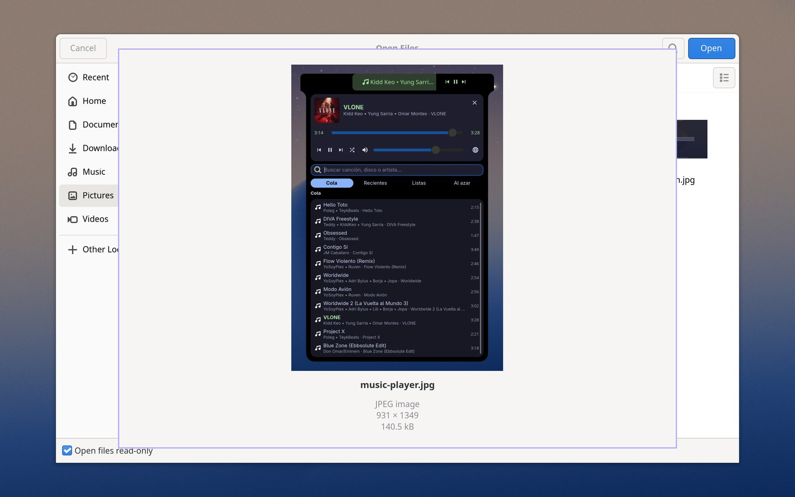 
  Three files further with the arrow keys: a portrait image fitted in the same window.

  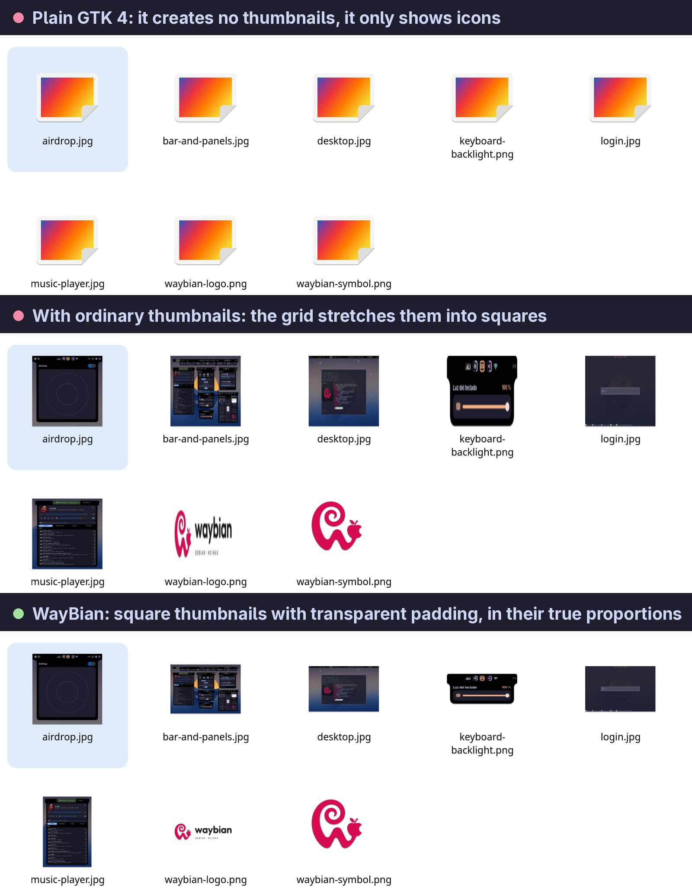 
  The same folder in the dialog's grid: plain GTK 4 (icons only), ordinary thumbnails (stretched) and the square ones.

